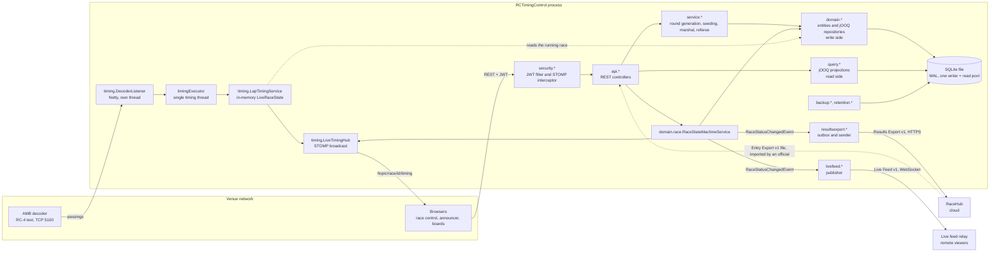

# Components

One Spring Boot process, one SQLite file. The packages below are under `dev.monkeypatch.rctiming`.

## Reading the picture

- **Write side and read side.** Entities and their `@Repository` classes (`domain.*`) change data; `query.*` builds views in SQL. Both go through jOOQ. See [architecture](../architecture.md#cqrs-lite-split).
- **The timing thread.** The decoder thread only hands passings to `timingExecutor`; they are handled one at a time, in decoder order, and that thread is the only one that updates a race's `LiveRaceState`. Live positions are never written to the database during a race.
- **Events.** `RaceStatusChangedEvent` is how the state machine tells audio, the race clock, the live feed, results export and practice that a race moved, without depending on them.
