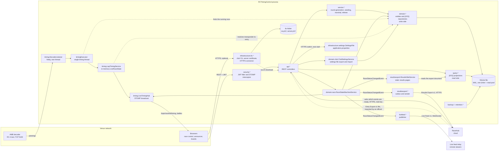

# Components

One Spring Boot process, one SQLite file. The packages below are under `dev.monkeypatch.rctiming`.

## Reading the picture

- **Write side and read side.** Entities and their `@Repository` classes (`domain.*`) change data; `query.*` builds views in SQL. Both go through jOOQ. See [architecture](../architecture.md#cqrs-lite-split).
- **The timing thread.** The decoder thread only hands passings to `timingExecutor`; they are handled one at a time, in decoder order, and passings are applied only on that thread. Marshal laps, penalties and transponder links come from request threads, and `LiveRaceState`'s locking serialises them with the passings. Live positions are never written to the database during a race.
- **HTTPS.** When `rctiming.https.enabled` is on, `HttpsConnectorCustomizer` adds a second Tomcat connector beside HTTP. `TlsService` keeps a club certificate authority and a server certificate in the data folder's `tls` folder, re-issues the server certificate when the laptop gains a name or it nears expiry (checked every ten minutes), and tells the connector to reload. Only the authority's certificate is served, at `/api/v1/about/ca.crt`.
- **Events.** `RaceStatusChangedEvent` is how the state machine tells audio, the race clock, the live feed, results export and practice that a race moved, without depending on them.
