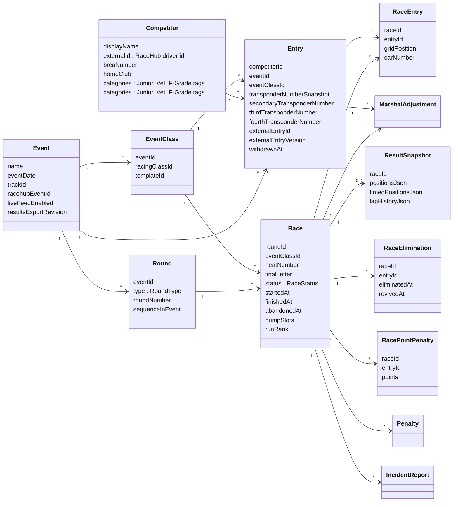
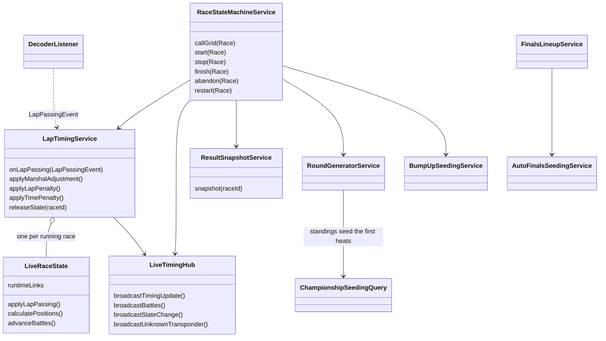

# Domain model

Entities are plain classes holding ids, not associations, so the diagrams show ids as the links. Each entity has a `@Repository` extending `persistence/JooqRepository`.

## Entities (write side)

Transponders belong to an `Entry`, not to a `Competitor`: a primary and an optional secondary number per entry, not unique across the system.

## Services around the race (write side)

## Tables (entity relationship)

The core of the SQLite schema (`app/src/main/resources/db/migration/sqlite`). Audit tables, tokens and the practice tables are left out.

```mermaid
erDiagram
    tracks ||--o{ events : "hosts"
    events ||--o{ event_classes : ""
    events ||--o{ rounds : ""
    events ||--o{ entries : ""
    events ||--o{ results_outbox : ""
    racing_classes ||--o{ event_classes : ""
    race_format_templates ||--o{ event_classes : "snapshot at assignment"
    scoring_systems ||--o{ race_format_templates : "picked by id in the Points Finals config; values copied on save and on adding a class"
    scoring_systems ||--o{ championships : "applied by copy: fields and points scale, no link kept"
    scoring_systems {
        text kind "RACE or CHAMPIONSHIP"
        bool built_in "locked, clone to change"
        json config "type: CLASSIC, BRCA, PLACE_POINTS"
    }
    racing_classes {
        text colour "#rrggbb picked by the club, null for none"
    }
    championships {
        text split_categories "category tags the standings are also split by, comma separated"
    }
    board_views {
        text slug "address: /boards/view/slug, unique"
        int columns "1 to 3"
        json panels "ordered: type, top, span; no foreign keys, a layout only"
    }
    audio_templates {
        text name "unique ignoring case"
        json settings "a ClubAudioSettings copy without the club's sound files; no foreign keys"
    }
    overlay_themes {
        text name "unique, e.g. BRCA, Club"
        boolean is_default "at most one true (partial unique index): the theme the plain /boards/overlay opens; club-wide"
        json design "the Overlay Designer's choices; opened as /boards/overlay?look=id; a look only; its sponsors are overlay_theme_sponsors"
    }
    overlay_themes ||--o{ overlay_theme_sponsors : "sponsors the theme owns; shown instead of the event's when any; cascade on delete"
    competitors ||--o{ entries : ""
    events ||--o{ event_sponsors : "name and logo for the overlay's sponsor bar"
    competitors ||--o| competitor_media : "optional headshot and driver sponsors; erased on anonymise and merge"
    entries ||--o| entry_photos : "optional car photo"
    entries ||--o| entry_car_colours : "optional car colours (#685); not personal data, so kept on anonymise"
    event_sponsors {
        text logo_url "object storage /storage/..., random name"
        int sort_order "display order"
    }
    overlay_theme_sponsors {
        text logo_url "object storage /storage/..., random name"
        int sort_order "display order"
    }
    competitor_media {
        text headshot_url "object storage"
        text sponsors "up to 5, newline separated"
    }
    entry_photos {
        text car_photo_url "object storage"
    }
    entry_car_colours {
        text colours "1 to 4 #rrggbb, comma separated"
    }
    event_classes ||--o{ entries : ""
    rounds ||--o{ races : ""
    event_classes ||--o{ races : ""
    races ||--o{ race_entries : ""
    entries ||--o{ race_entries : ""
    races ||--o| result_snapshots : ""
    races ||--o{ marshal_adjustments : ""
    races ||--o{ race_eliminations : "Shikabane"
    races ||--o{ race_point_penalties : "Shikabane"
    races ||--o{ penalties : ""
    races ||--o{ incident_reports : ""
    entries ||--o{ marshal_adjustments : ""
    championships ||--o{ championship_classes : ""
    championships ||--o{ championship_event_links : ""
    events ||--o{ championship_event_links : ""
    racing_classes ||--o{ championship_classes : ""
    users ||--o{ user_roles : ""
```

