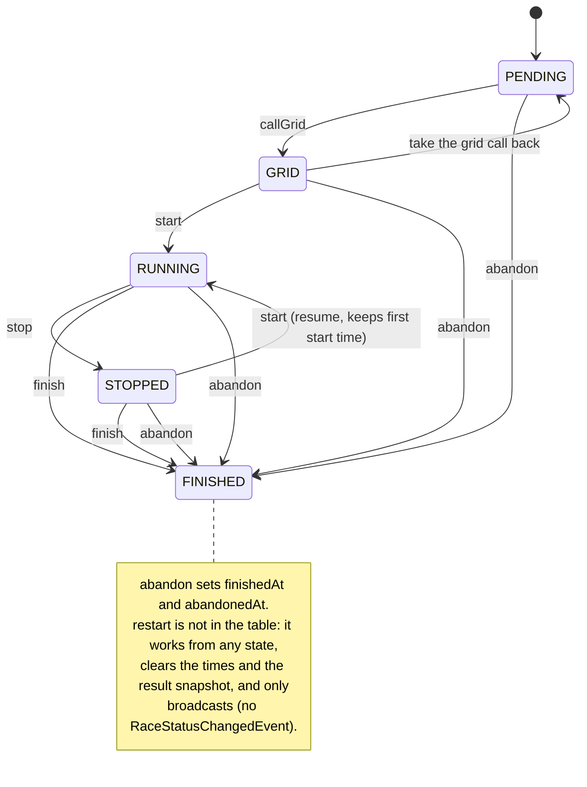
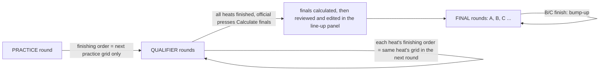
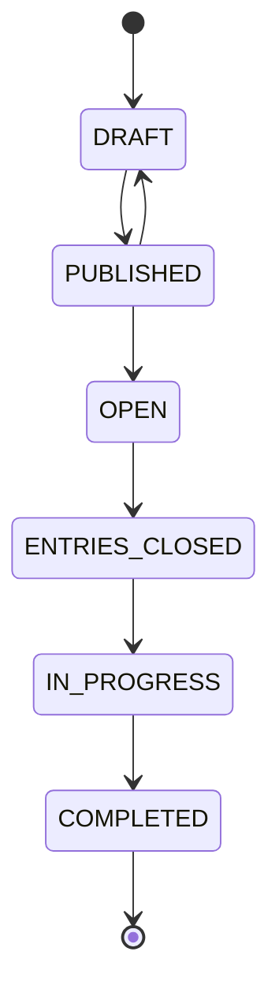

# Race lifecycle

`RaceStateMachineService` owns every status change (`domain.race`). Each command checks one table of allowed transitions and throws `IllegalStateTransitionException` (HTTP 409) otherwise.

`callGrid` and the first `start` of a final also require every qualifying heat of its class to be finished (an abandoned heat counts as finished).

## What happens when a race reaches FINISHED

`move(race, FINISHED)` in `RaceStateMachineService`:

1. saves the race (so listeners read its new status and times from the database);
2. publishes `RaceStatusChangedEvent` and broadcasts to `/topic/race/{id}/state`;
3. `applyFinishingOrderToNextRace`: a practice or qualifier heat sets the starting grid of the same heat in the next round; a lower final promotes bump-up drivers into the next final up and broadcasts a bump-up alert;
4. `ResultSnapshotService.snapshot` persists the result snapshot (the only time positions are stored);
Finals are not seeded by the finish: an official presses Calculate finals, and `AutoFinalsSeedingService.reseed` seeds them from the snapshots; `FinalsLineupService` then edits the grids until a final is called. Once every qualifying heat is finished the cockpit gives way to the finals line-up screen (`FinalsLineupService.review`, `events.finals_lineup_confirmed_at`) until race control confirms the line-ups; seeding again clears the confirmation.

## Rounds around a race

Practice does not set qualifying order (qualifying starts in car number order); qualifier to qualifier does. Heat 1 of a class starts in car number order; every later round starts each heat in the finishing order of the same heat in the round before, taken from the stored result so penalties and marshal laps count, and re-applied if a correction changes it before that heat starts. Cars that did not appear in the result start behind the finishers. Car numbers never change with the grid.

## The event around the races

The race day has its own states (`domain.event`). `EventStateMachineService` only checks the transition; `EventService.transition` saves it, and completing an event publishes `EventCompleted`, which asks for a day-close [results export](sequences.md#results-export-to-racehub).

