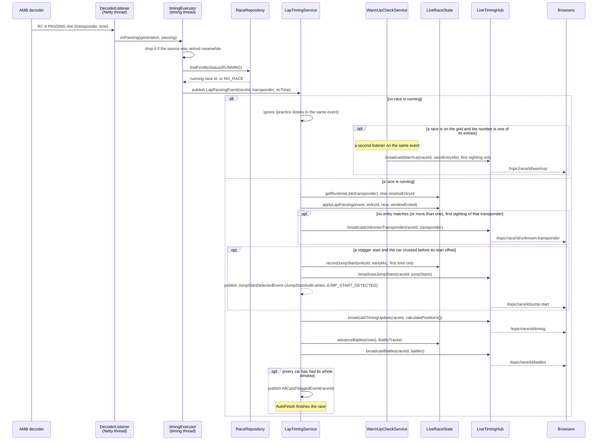
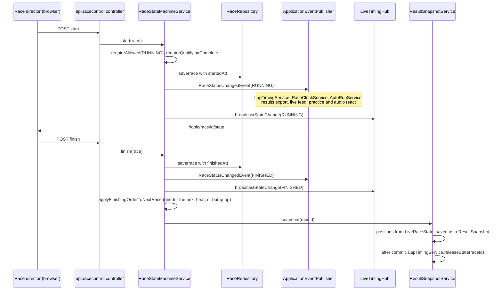
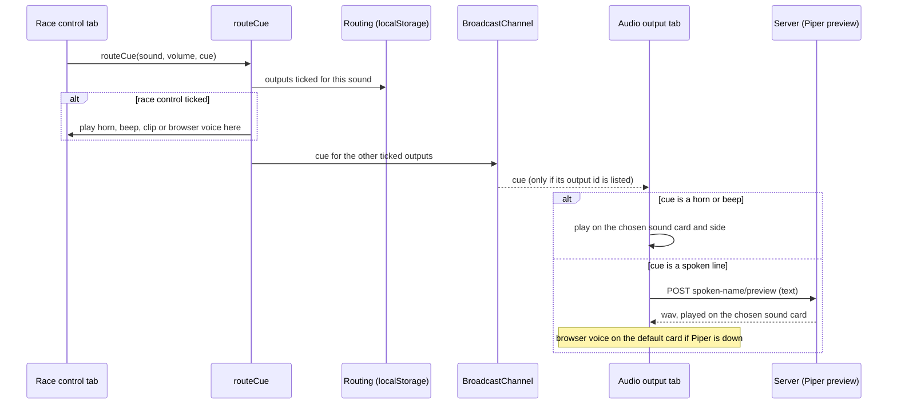
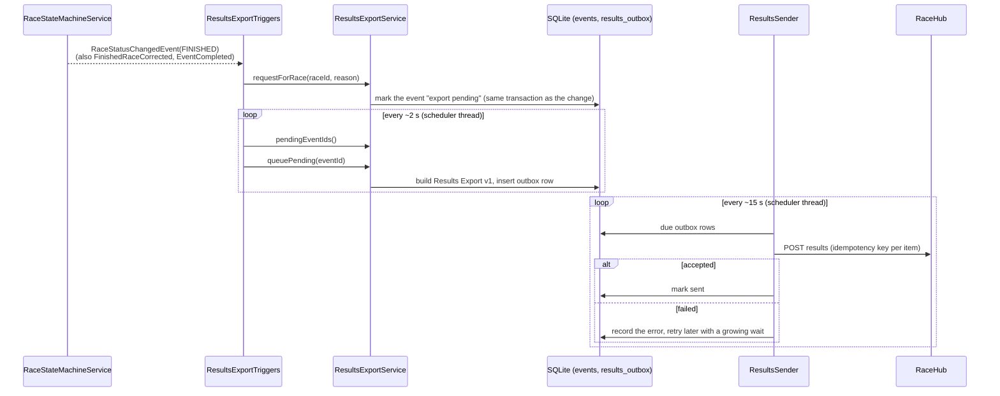
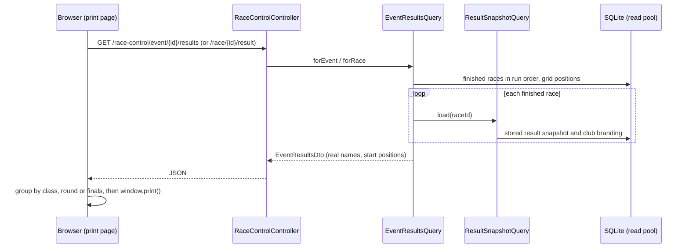
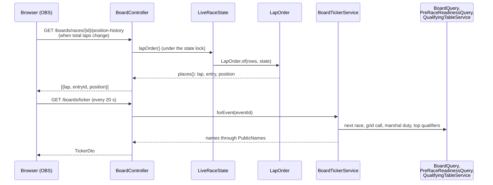
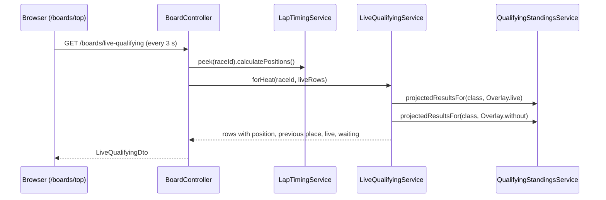
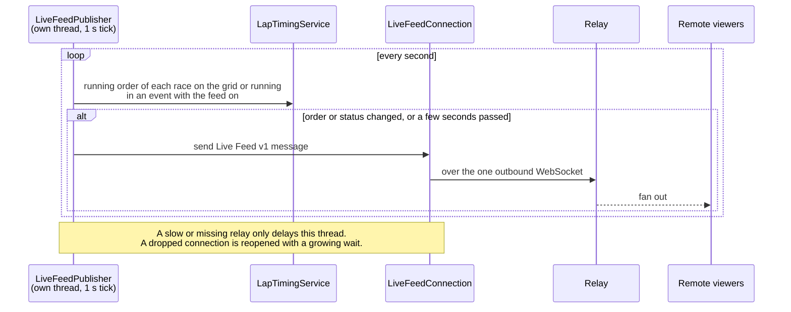
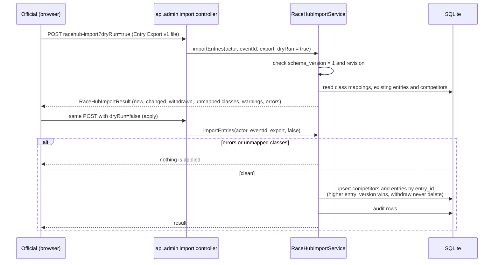
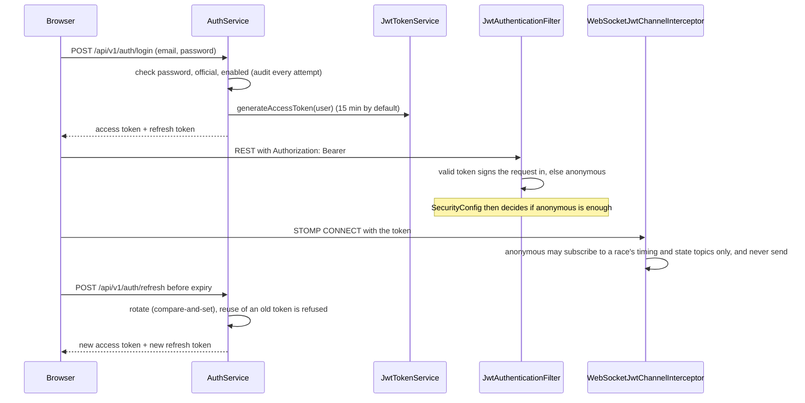

# Sequences

Each diagram follows one thing through the code. Class names are the real ones, under `dev.monkeypatch.rctiming`.

- [A lap passing, decoder to browser](#a-lap-passing-decoder-to-browser)
- [Starting and finishing a race](#starting-and-finishing-a-race)
- [Results export to RaceHub](#results-export-to-racehub)
- [Officials' printouts](#officials-printouts)
- [The overlay's chart and ticker](#the-overlays-chart-and-ticker)
- [Live feed to the relay](#live-feed-to-the-relay)
- [Importing entries from RaceHub](#importing-entries-from-racehub)
- [Signing in and staying signed in](#signing-in-and-staying-signed-in)

## A lap passing, decoder to browser

The decoder thread never touches the database. Everything after `timingExecutor.execute` runs on the one timing thread, so passings are handled one at a time in decoder order.

A car that crosses the line before its turn in a stagger start is flagged to the referee, who decides on a penalty or takes no action; the passing is still timed. The detection is audited as `JUMP_START_DETECTED`. Taking no action (`RefereeService.dismissJumpStart`) writes a `JUMP_START_DISMISSED` audit row and marks the entry dismissed in `LiveRaceState`; the list is broadcast again, the alert goes and the entry keeps its lozenge. A penalty dismisses it the same way and writes a `JUMP_START_PENALISED` row beside its `PENALTY_APPLIED` one.

An unknown transponder is never silently credited: it goes to the race director, who links it to an entry (`TransponderLinkService`), and the link applies back over the passings already seen.

## Starting and finishing a race

Shikabane eliminations are not state changes either: `RaceEliminationService` saves a `RaceElimination` row for a car marked dead (or a revival), and `ResultSnapshotService` reads the active rows when it works out the heat result, ordering the dead after the survivors through `ShikabaneOrdering`. On a finished race it publishes `FinishedRaceCorrected` so the result is rebuilt. When a Shikabane heat finishes, `RaceStateMachineService` calls `ShikabaneGridService` after the snapshot to draw the next heat's grid (reverse of the result, then cumulative `ShikabaneHeatScores`). A Shikabane class with `mains` above 0 has finals too: `AutoFinalsSeedingService` (on the official's Calculate finals) seeds them through `BumpUpSeedingService` using the config's `mainGridSize` and `promotionSpots`, and a finishing lower main promotes its best finishers as in a bump-up format. A zombie round is a final with letter `Z` that `BumpUpSeedingService` leaves out of the seeding, fills with everyone outside A when the main below A finishes, and whose winner is promoted into A through the extra bump place A is given.

Marshal laps are not state changes: `MarshalService` saves a `MarshalAdjustment` and calls `LapTimingService.applyMarshalAdjustment`, which recalculates and rebroadcasts positions.

## Race audio routing

Race control works out every sound (horns, beeps, spoken lines) in the browser; nothing about audio is decided on the server. Each sound goes through `routeCue` in `lib/audioOutput.ts`, which looks up the outputs the club ticked for it in `lib/audioRouting.ts` (kept in `localStorage`). It plays the sound on race control's tab if that output is ticked and sends the rest to the other tabs of the same browser over a `BroadcastChannel`. An audio output page announces itself on the channel every three seconds; a sound ticked for an output that has not been heard from for six seconds plays on race control instead of being lost. An audio output page (`/audio-output/{id}`) listens for cues meant for its output and plays them on its sound card (`setSinkId`) and speaker side (a stereo pan), speaking text, cut into pieces of at most 100 characters and played in turn, with the club's Piper voice because the browser voice cannot leave the default card.

## Results export to RaceHub

The export is an outbox, so a finish never waits on the network and a crash loses nothing.

Format: [Results Export v1](../results-export-v1.md).

## Officials' printouts

The round summary, final results, meeting pack and heat result are print-styled web pages (the browser does the paper or Save as PDF). They read from one officials-only endpoint, so they show real names where the public pages follow each competitor's public name setting, and they add the grid each driver started from.

The qualifying standings in a meeting pack come from the existing `GET /race-control/event/{id}/qualifying`. The championship sheet is the public standings page plus `GET /championships/{id}/info` for the class names.

## The overlay's chart and ticker

The streaming overlay and the Live race screen (`/boards/live-race`) all draw the same position chart. The running order comes live over STOMP; the places lap by lap come from one anonymous read that is repeated whenever the field's total laps change. The ticker's text is read on a slow poll. The chart read holds `LiveRaceState`'s lock only to copy the rows and lap times; the ordering is worked out after the lock is released.

The Now and next board polls the same ticker endpoint for the next drivers and marshals.

The Live top screen (`/boards/top`) and the overlay's timing tower (the projected qualifying place on each row of a qualifying heat) poll `GET /boards/live-qualifying` every three seconds. `BoardController` picks the qualifying heat (the one on track, else the last one finished) and passes the heat's live rows from `LapTimingService.peek` to `LiveQualifyingService`. That asks `QualifyingStandingsService.projectedResultsFor` twice: once with the heat counted (`Overlay.live`, or `Overlay.stored` after it finished) and once without it (`Overlay.without`) for the places before. Only the board's response is built; nothing is stored.

A saved board view (`/boards/view/{slug}`) reads only its layout from `GET /boards/views/{slug}` (`PublicBoardViewController` and `BoardViewService`). The page follows the race on track once through `useBoardRace` and each panel then polls the same public endpoints as the stand-alone boards, so a view adds no timing load of its own.

`LapOrder` is also what `ResultSnapshotService` uses to store the lap history of a finished race, so the printed chart and the live chart agree.

## Live feed to the relay

Format: [Live feed v1](../live-feed-v1.md).

## Importing entries from RaceHub

Entries are never created for a racer login: competitors have no account.

## Signing in and staying signed in

