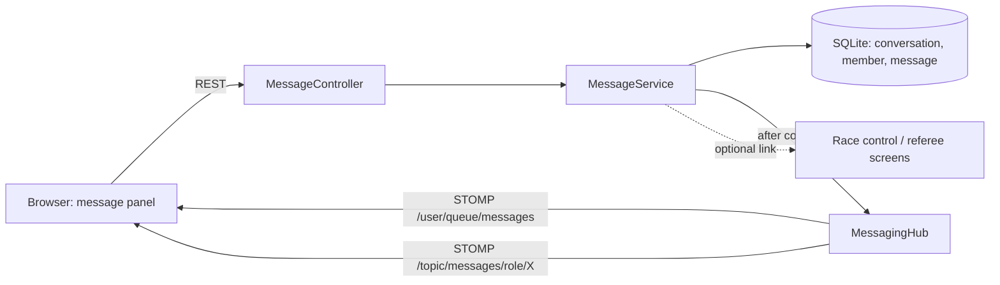

# Messaging module for RCTC: design (draft 1)

Status: idea, not scheduled (label `idea`, milestone "Ideas backlog"). Tracker #542 with sub-issues #543 to #549; the AI commentator assistant is #552; the system log channel is #TBD. Analysis only; no code written. This records the context so the ideas can be discussed later.

## 1. Decision

No external message broker. RCTC already has the in-process STOMP broker (`config/websocket/WebSocketConfig`) and JWT sign-in for officials. The module adds the two things the broker does not give: stored history (so late joiners and reconnects lose nothing) and a UI. Brokers stay out of scope (`docs/REQUIREMENTS.md`).

## 2. Who uses it

| Person | Uses messaging to |
|---|---|
| Race director / organiser | Tell referees and marshals what is happening, pin announcements for the commentator |
| Referee | Ask race control about an incident, tell the director a penalty is coming |
| Marshal (phone) | Call for help, report a problem at a corner |
| Commentator | Receive notes and pinned announcements, ask for gap checks |
| Admin | Switch the module on or off. Does not read private chats. |

Racers have no accounts, so they are not part of this.

## 3. Module boundary

A self-contained `messaging/` package, like `livefeed/` and `resultsexport/`:



Nothing outside the package depends on it. A club setting turns it off (menu item and endpoints disappear).

## 4. Data model

```mermaid
erDiagram
  CONVERSATION ||--o{ CONVERSATION_MEMBER : has
  CONVERSATION ||--o{ MESSAGE : contains
  CONVERSATION { id pk; kind "DIRECT|GROUP|ROLE"; title; role "for ROLE only"; event_id "optional"; created_at "UTC micros" }
  CONVERSATION_MEMBER { conversation_id; user_id; last_read_message_id; muted }
  MESSAGE { id pk; conversation_id; sender_id; body; urgent; race_id "optional"; pinned; sent_at "UTC micros" }
```

- ROLE conversations ("All referees", "Race control", "Marshals", "Everyone") are created by the module; membership is derived from the user's roles.
- Timestamps are UTC microseconds like every other column. jOOQ repositories, Flyway migration, no ORM.

## 5. API

| Call | Purpose |
|---|---|
| `GET /api/v1/messages/conversations` | List with unread counts |
| `GET /api/v1/messages/conversations/{id}?before=` | History, newest first, paged |
| `POST /api/v1/messages/conversations` | Start a direct or group chat |
| `POST /api/v1/messages/conversations/{id}/messages` | Send (body, optional race link, urgent) |
| `POST /api/v1/messages/conversations/{id}/read` | Move read marker |
| `PUT /api/v1/messages/conversations/{id}/mute` | Mute or unmute |

All require a signed-in official and membership of the conversation (403 otherwise). Body length capped (say 1000 characters). Send is rate limited per user.

## 6. Real-time delivery

- Direct and group: `/user/queue/messages` (per-user, uses the JWT already on the STOMP CONNECT).
- Role channels: `/topic/messages/role/{ROLE}`, with a subscribe interceptor that checks the role.
- The service publishes after the transaction commits, so a client never sees a message that is not stored.
- On reconnect the client fetches conversations and fills the gap from the database.

## 7. Screens (wireframes)

Header icon with unread badge, opening a side panel.

```
 Race control                       [🔔] [✉ 3] [Dave ▾]
 ──────────────────────────────────────────────────────
                              ┌───────────────────────┐
                              │ Messages           ✕  │
                              │ [ New message ]       │
                              │───────────────────────│
                              │ ● All referees    2   │
                              │   Ref: car 5 contact… │
                              │ ● Sam (referee)   1   │
                              │   On my way           │
                              │   Marshals            │
                              │   Commentator         │
                              └───────────────────────┘
```

Conversation view:

```
 ┌─ All referees ─────────────────── 🔕 ─┐
 │ Sam   10:42                           │
 │  Car 5 and 9 touched, lap 14          │
 │            Dave 10:43  [Heat 3, 1/2]  │
 │            Looking now                │
 │ ⚠ URGENT  Marshal Jo 10:44            │
 │  Marshal needed turn 3                │
 │───────────────────────────────────────│
 │ Presets ▾ │ Link race ▾ │ ☐ Urgent    │
 │ [ type a message…            ] [Send] │
 └───────────────────────────────────────┘
```

Toast on arrival: "Sam: Car 5 and 9 touched…" with Open. Urgent messages stay until dismissed and can reuse the existing alert and audio hooks. Marshal phone layout is the same panel full-screen.

Race link: a message tied to a race shows a chip, and the race control and referee screens show a small "N messages about this race" strip.

## 8. Commentator extras (builds on #481 and #516)

The commentator board view (#481) and the overlay driver cards panel (#516) already exist. These add to them, not a new view.

1. **Commentator in messaging**: a ROLE conversation "Commentator". A new stackable `COMMENTATOR` role (decided): sees board views, the commentator desk and messaging, not race control. Needs the roles table, CLAUDE.md roles table and admin officials screen updated.
2. **Pinned announcements**: organiser pins a message ("Lunch 12:30", "Prize-giving after finals"); it shows as a banner on the commentator view until cleared.
3. **Driver notes**: short free text per competitor ("first race today", "returning after repair"), shown in the existing driver cards beside sponsor and photo. Stored against the competitor, display names only, not sent to the live feed.
4. **Talking-points panel**: a new `BoardPanelType` fed by existing data: battles, fastest lap, lap records, bump-ups, penalties, lead changes, championship situation.
5. **Race-day script cards**: next race line-up with names, numbers, class, format and what is at stake.

```
 Commentator view
 ┌───────────────┬─────────────────────────────┐
 │ Live order    │ Talking points              │
 │ 1 #3 Alex     │ ⚔ #4 v #7 gap 0.3s closing  │
 │ 2 #7 Sam      │ ⚡ Fastest lap #3 12.41      │
 │ 3 #4 Jo       │ ↑ Bump-up: #12 into A final │
 ├───────────────┼─────────────────────────────┤
 │ Driver card   │ 📌 Lunch 12:30              │
 │ #7 Sam · note │ ✉ Race control: restart 2m  │
 └───────────────┴─────────────────────────────┘
```

### 8b. Streaming commentators at bigger meetings (added after Dave's note)

Commentators at bigger meetings talk live on YouTube or similar, usually with OBS using RCTC's overlay (`/boards/overlay`, #29). They need a screen that works in a second browser window next to the stream, with no clutter and nothing that can leak to viewers.

- **Commentator desk page**: one screen, dark, large text, built from the existing board view panels. Panels: live order with gaps, driver card for the selected car, talking points, pinned announcements, incoming messages, next race line-up. Separate from the overlay so the audience never sees the notes.
- **Selected car**: click a car in the live order and its driver card (photo, sponsor, notes, best lap, battles) comes up. Optionally auto-follow the leader or the closest battle.
- **Delay awareness**: stream video usually lags real time by 10 to 30 seconds. A setting for "stream delay" (seconds) lets the desk show a "what viewers see now" marker, and lets the overlay delay its own data to match the video (open question, needs testing with OBS).
- **Safe for viewers**: the desk is behind sign-in (or a commentator link) and shows only display names. Private notes and messages never appear on the overlay or the live feed.
- **Between races**: next race line-up with names and numbers, class, format, championship stakes, and a "read-out" mode with big text for sponsor shout-outs the organiser pushes in.
- **Hand-off messages**: quick presets from race control to the commentator ("restart in 2 minutes", "red flag, car 5") and a one-tap "need a gap check" back.

These become part of #548 (desk page, delay) and #549 (talking points); I can split the desk page into its own sub-issue if you prefer.

### 8c. AI commentator assistant (idea from Dave, design question only)

Idea: the assistant is a participant in the messaging module. The commentator asks it things in a chat ("who has won most here?", "is #7 faster than usual?"), and big events also feed it live race events so it can offer facts unprompted. Nothing here is decided or built.

**Where it fits.** A built-in "Assistant" conversation per commentator, plus an optional "Assistant suggestions" feed on the commentator desk. It reuses the messaging tables, STOMP delivery and the `COMMENTATOR` role, so it costs little extra UI. Assistant messages are marked as such.

**Two layers, so offline still works**

1. **Stats engine (no AI, always on, works offline).** Fixed, tested jOOQ queries over data RCTC already keeps forever: laps and results per competitor per track, personal bests, track records, head-to-head, recent form, championship position, streaks, gap trends from the battles tracker. Triggered by live events (new fastest lap, lead change, bump-up, close battle) to produce short suggestion cards. This layer is where most of the value is and carries no risk of wrong facts.
2. **Language assistant (optional, needs a model).** Understands free-text questions and phrases the answers. It never writes SQL. It calls a small set of read-only "tools" that wrap the stats engine (for example `driverHistoryAtTrack(competitor, track)`, `trackRecords(class)`, `headToHead(a, b)`, `currentBattles()`, `championshipStanding(class)`), then answers only from what those return and says where each fact came from.

**Data sources**
- RCTC's own database: full race history stays with RCTC, so history is strong for this club's own track. Coverage is limited to what the club has run in RCTC.
- Live state in memory: positions, gaps, battles, laps remaining, current race and next race.
- Driver notes and pinned announcements from the commentator items.
- Not used by default: anything from RaceHub, other clubs or the web. RaceHub history across venues could be a later source if RaceHub offers it.
- Anything personal stays out: RCTC holds display names only, and only names, numbers, classes and times are sent to a model.

**How prompts work**
- A fixed system prompt sets the role (short, factual, spoken-aloud-friendly, no guessing) and the tool list. The commentator's question and a compact snapshot of the current race are added each turn.
- Events (fastest lap, lead change, bump-up) go through the stats engine first. Only an interesting, throttled subset (say at most one suggestion per 30 seconds) is shown, and the model is only used to polish wording, if at all.
- Answers show their sources ("from 14 heats since March") and say "no data" rather than guess. Responses cache per race so repeats cost nothing.

**Offline and local-only**
- The venue may have no internet. Layer 1 needs none. Layer 2 can use either:
  - **Local model** on the laptop through a local runtime (small models are weak and slow on a race laptop that is also running timing; viable on a second machine on the LAN), or
  - **Cloud model** when the venue has internet, with the club's own API key and a clear "sends names and times to an AI provider" notice. If offline, the assistant says so and the stats engine carries on.
- A club setting chooses: off, stats only, or stats plus language assistant (local or cloud). Default is stats only, in line with RCTC's no-internet-required rule.
- The model must never be on the timing path: it runs on its own thread, rate limited, with timeouts, so a slow model cannot affect lap capture or the live timing screens.

**Risks to think about**
- Wrong facts read out live on a stream. Mitigation: grounded tool answers with sources, "no data" over guessing, and a human (the commentator) always in the loop.
- Cost and keys for a cloud model, and sending data to a third party: opt-in, per-event switch, display names only, nothing stored by RCTC beyond the chat.
- Laptop load with a local model, and answer latency during a race.
- Scope: a tracker-worthy item of its own, after the stats engine proves useful.

**Suggested path**
1. Stats engine and suggestion cards on the commentator desk (no AI).
2. Chat "ask" with the tool-calling assistant over the same queries.
3. Local model option, if it proves usable on club hardware.

### 8d. System log channel (idea from Dave: use chat for remote logs)

Idea: the messaging module gets a read-only "System log" channel that RCTC itself posts to, so officials (and Dave) can follow what the system is doing without sitting at the race control laptop. Not decided, not built.

**What would be posted** (a short, human readable line each, with a severity):
- Decoder connected, disconnected, silent for N seconds, or restarted.
- Timing faults: unknown-transponder bursts, a gap in decoder passing numbers, a car with no passings, clock or anchor problems.
- Race lifecycle oddities: a race stopped by an error, a restart or abandon, a marshal absence recorded.
- Housekeeping: backup finished or failed, disk space low, results export or live feed failing and retrying, a login lockout.
- Application WARN and ERROR entries, filtered to a short safe summary (no stack traces, no personal data).

**How it fits.** A new conversation kind `LOG` next to DIRECT, GROUP and ROLE. Posting is by the system only; people read, mute and filter by severity. It reuses the same tables, STOMP delivery and unread badge. A small `SystemLogPublisher` listens to the existing Spring events and a logging appender, and a throttle collapses repeats ("decoder disconnected, 14 times in 5 minutes"). Retention for this channel can be shorter than chat (for example 7 days). Admins see it by default; other roles by choice. It does not replace the log files or the audit log, which stay the full record.

**Local-only and offline.** On the venue network it works exactly like chat: the browser has the same STOMP connection and nothing leaves the building. Because it is stored, someone who opens a browser mid-meeting sees what has happened so far.

**What "remote" means decides the design**
- **Elsewhere on the venue LAN** (a marshal's phone, the announcer's tablet, a second laptop): no extra work.
- **Off-site** (Dave at home, a club official watching a meeting): RCTC takes no inbound connections and is not on the internet, so this needs an outbound path, as the live feed already does with its one outbound WebSocket to a relay (`livefeed/`). Options: reuse that relay for a log stream (opt-in, display names only), or send severe alerts only by email or a push service, or have the laptop upload a log bundle after the meeting. Each has a cost in setup and in what leaves the venue, so it should be a deliberate club setting, off by default.

**Risks.** Noise (hence severity levels and throttling), leaking personal data or internals into a channel others can read (hence summaries only, role-limited), and a log flood slowing the database (bounded rate, separate retention, never on the timing thread).

## 9. Privacy, retention, backups

- Messages never leave the venue: not in the live feed, not in the RaceHub results export.
- Admins can read every conversation (Dave's decision). The panel says so, and each admin read of someone else's chat is audit-logged. Other roles only see conversations they belong to.
- Retention: a purge job deletes messages older than N days (club setting). Messages are chatter, not race history, so the "keep all race history" rule does not apply to them.
- Backups copy the whole database, so they include messages. Say so in `docs/data-protection.md`.
- Anonymising a user removes their name from message display but keeps the text unless retention has already cleared it.

## 10. Delivery plan

| Issue | Content |
|---|---|
| #543 | Schema, repositories, REST API, club on/off setting |
| #544 | STOMP delivery and catch-up |
| #545 | Frontend panel, badge, toasts |
| #546 | Race links, presets, urgent flag |
| #547 | Retention, privacy, backups, docs |
| #548 | Commentator role, pinned announcements, driver notes |
| #549 | Talking-points panel |

Suggested order: #543, #544, #545, then #546 and #547, then the commentator items. Each PR carries Javadoc, developer diagrams and user guide text as per CLAUDE.md rule 5.

## 11. Decisions (Dave, 2026-10-26)

1. Retention: messages are cleared after N days (club setting, default to be chosen, suggest 30).
2. Commentator: a new stackable `COMMENTATOR` role.
3. Admins can see everything, including private chats. Because of that, the chat panel tells people that admins can read messages, and admin reads of other people's conversations are audit-logged.
4. Messaging is on by default; a club turns it off by choice in settings.
5. Still to confirm: v1 scope of text only, no attachments, no edit or delete, no push outside the browser.
