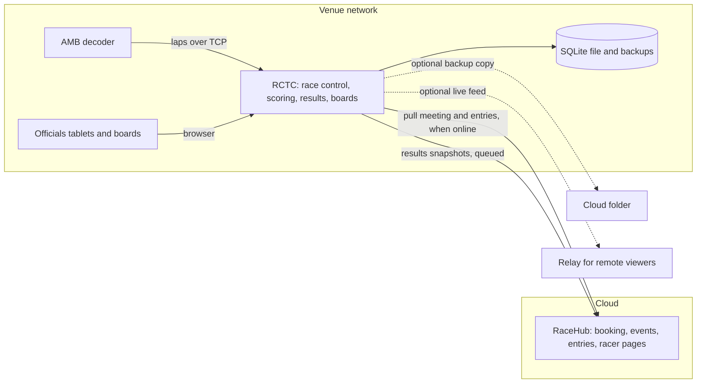
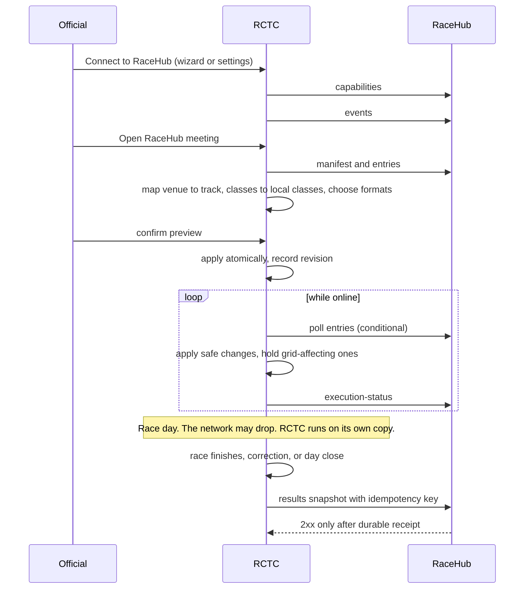

# RCTC and RaceHub integration: design

Status: proposed design, not implemented behaviour. Drafted 24 October 2026.

This page is the design for RCTimingControl (RCTC) and how it connects to RaceHub. It builds on the [integration plan](README.md) (tracker [#384](https://github.com/RCRaceHub/RCTimingControl/issues/384), packages C01 to C12) and does not replace it. It covers RCTC. RaceHub is the counterpart system: where it matters, this page states what RCTC expects of it, but RaceHub's own design and priorities are its own.

It summarises and links to the detailed documents instead of repeating them.

## Summary

RaceHub organises the meeting. RCTC runs it. RaceHub owns events, classes, racer identity, bookings, entries and attendance. RCTC owns the decoder, laps, race control, formats, heat generation, seeding, results and championships. They connect through a few small versioned contracts that RCTC always starts. RCTC works fully on its own and keeps every race history.

Goals:

- Event and race organisation stay in RaceHub. RCTC only times.
- Results go back to RaceHub so racers can see past results and performance.
- RCTC works standalone, by default.
- A race day survives no network.
- RCTC keeps every race history.

Not goals: a shared database, shared logins or single sign-on; a two-way sync engine; racer accounts in RCTC; lap-level data in RaceHub in the first version; internet deployment of RCTC.

## Where the detail lives

| Topic | Document |
|---|---|
| RCTC structure and decisions | [architecture](../../architecture.md), [developer docs](../../developer/README.md), [PROJECT](../../PROJECT.md), [REQUIREMENTS](../../REQUIREMENTS.md) |
| Formats and scoring | [race-types](../../race-types.md), [scoring](../../scoring.md) |
| Contracts | [api](../../api.md), [results-export-v1](../../results-export-v1.md), [live-feed-v1](../../live-feed-v1.md) |
| Integration plan and work packages | [README](README.md) |
| This design | this page |

## Decisions

| Decision | Date |
|---|---|
| RaceHub organises, RCTC runs. No shared database, shared login or remote race commands. | 19 Oct (plan) |
| RCTC is local-only timing on a venue laptop or club server. One club per instance. | Oct 2026 (#8) |
| RCTC works standalone. Publishing results is a club setting (#319). | 16 Oct |
| Standalone is the default. The wizard offers "Connect to RaceHub". One mode per instance. Local meetings stay allowed in a paired instance, each marked "Managed in RaceHub" or "Local". | 24 Oct |
| Practice always works, even when connected and offline. | 24 Oct |
| RCTC keeps every race history. | 24 Oct |
| Championship points are calculated in RCTC only. RaceHub displays what it receives. | 24 Oct |
| RaceHub receives result summaries only for now. RCTC keeps every lap locally. | 24 Oct |
| Walk-ins: going through RaceHub is preferred. RCTC also supports walk-ins that stay unlinked until an organiser links them, as the override. | 24 Oct |
| All heat generation, seeding, formats and run order stay in RCTC. | 24 Oct |
| Practice best laps are not sent to RaceHub in the first version. | 24 Oct |
| The contract files (OpenAPI, schemas, golden examples) live in this repository. RaceHub may use them or not. | 24 Oct |
| Passkeys and optional local HTTPS are deferred. The naming step can ship without HTTPS. | 24 Oct |
| Cloud backups start with a sync-folder guide and no code. Uploaders come later if wanted. | 24 Oct |
| Results sending is built and tested against a test RaceHub with fictional data. Real results are sent only once RaceHub is ready to receive them. | 24 Oct |

## System context

RCTC always opens the connection. The venue laptop is not reachable from the internet, so RaceHub never calls it.

## RCTC in brief

The detail is in [architecture](../../architecture.md) and the [developer diagrams](../../developer/README.md).

- One Spring Boot process and one SQLite file, installed as a background service. The same process serves the React app, the REST API and the WebSocket.
- Timing path: decoder TCP client on its own thread, then one timing thread, then in-memory live state, then STOMP broadcast. Live positions are not written to the database during a race.
- Write side through jOOQ repositories, read side through query classes. No ORM.
- Race state machine `PENDING, GRID, RUNNING, STOPPED, FINISHED`. Each command publishes an event that audio, the clock, the live feed, results export and practice listen to.
- Competitors have no login. Entries carry a primary and an optional secondary transponder. Entries come from the RaceHub import, the URL feed, the RC-Timing CSV import or are added by hand.
- Outbound jobs (results outbox, live feed, backups) never hold up timing.
- Only officials sign in.

## What RCTC assumes of RaceHub

This records assumptions so the two sides can be checked against each other. It does not decide how RaceHub is built.

| Assumption | Why RCTC needs it |
|---|---|
| Authenticated, versioned reads for meetings, classes and entries, and an endpoint that accepts a results snapshot (the plan's integration endpoints). | RCTC only starts requests, so there must be something to call. |
| Entries carry stable ids, a version, explicit withdrawals and a revision for the whole event. | Safe replay and no duplicate entries. |
| Results are acknowledged only after durable receipt. A lower revision never overwrites a higher one. The same revision is safe to resend. | RCTC's outbox treats any 2xx as delivered. |
| Older schema versions keep working for about 12 months and the supported versions can be discovered. | Club laptops update rarely. |
| No contact, date of birth, guardian or payment data is ever sent to RCTC. | RCTC stores none of it. |
| Any extra access layer in front of RaceHub's API is RaceHub's choice, as long as RCTC can present a credential. | RCTC supports a bearer token and the connection settings can carry an optional extra header. |

## Integration

The integration follows the [plan](README.md#proposed-api-surfaces). Paths below use the plan's names.

| Endpoint (on RaceHub) | Purpose | Plan package |
|---|---|---|
| `GET /api/integration/v1/capabilities` | Supported schema versions and capabilities. Drives an "update needed" warning. | C01, C03 |
| `GET …/events` | Authorised meetings, paginated, with a date filter. | C03, C05 |
| `GET …/events/{id}/manifest` | Meeting details and the full class list, empty classes included. | C05 |
| `GET …/events/{id}/entries` | Entry Export v1 snapshot with explicit withdrawals. | C05 |
| `POST …/events/{id}/results` | Full results snapshot. Success only after durable receipt. | C08 |
| `GET …/events/{id}/results/status` | Receipt versus public publication. | C08 |
| `PUT …/events/{id}/execution-status` | Accepted revision, readiness, held changes, last reported state. | C06 |

Rules that hold on every call:

- **Auth:** a bearer token over HTTPS. RCTC stores it encrypted. The receiver validates ownership instead of trusting ids in the payload.
- **Entries:** keyed by provider plus entry id, applied only when the version is higher, withdrawals explicit, a missing row never a withdrawal, grid-affecting changes after preparation wait for an official.
- **Results:** each snapshot replaces the event's accepted projection, an older revision cannot regress it, the same revision with different content is a visible conflict, and results and championship ordering stay separate.
- **Failure:** network calls never block timing and never run inside a local write transaction. Results queue and retry with growing waits.
- **Privacy:** payloads carry display name, BRCA number and home club only. Public views are a separate projection from authenticated real-name receipts.

Existing contracts: [Entry Export v1](../../api.md#admin--racehub-import), [Results Export v1](../../results-export-v1.md), [Live Feed v1](../../live-feed-v1.md). The plan adds a separately versioned meeting manifest.

## Operating modes

- **Standalone is the default.** The first-run wizard offers "Connect to RaceHub". An admin can connect later without reinstalling or losing data.
- **One mode per instance.** Each club runs its own RCTC. Connecting changes where meetings and entries come from and where results go. The timing core never asks which mode is on.
- **Linked meetings** are marked "Managed in RaceHub" and enforced in backend services as well as the UI. Decoder, track execution, rules, audio, officials, backups and privacy operations stay local. A paired instance can still run local meetings, each marked "Local".
- **Practice** works the same in both modes, with no RaceHub meeting and no network needed. Drivers added on the spot are local competitors. Practice results are not sent in the first version.
- **Disconnect** pauses polling, queued sending and live publishing without deleting data. Resume verifies the destination and publisher before releasing queued work.

| | Standalone | Connected |
|---|---|---|
| Meetings | Created in RCTC | Opened from a RaceHub meeting, or created locally and marked "Local" |
| Entries | Walk-ins, RC-Timing CSV, any system's Entry Export v1 file | Pulled from RaceHub, plus walk-ins on the day |
| Imported fields | Editable | Read-only, with the source shown |
| Results go to | Nowhere, or a results site later | RaceHub, or both |

## What to sync

One owner per fact, copy only what the other side needs, refer to the rest by id, never copy personal data.

| Data | Direction | Decision |
|---|---|---|
| Meetings, classes in the meeting, entries, attendance | RaceHub to RCTC | Sync |
| Driver identity | RaceHub to RCTC | Minimal: RaceHub driver id, display name, BRCA number, home club |
| Transponders | RaceHub to RCTC | Per entry, primary and secondary. The garage is never read. |
| Car names, club-car names | RaceHub to RCTC | Name only |
| Results, penalties, standings, car numbers | RCTC to RaceHub | Sync, whole-event snapshot with a revision |
| Transponder changes seen on the day | RCTC to RaceHub | Later, as a proposal RaceHub reviews (C12) |
| Laps and passings, practice results | RCTC to RaceHub | Not in the first version |
| Tracks, class catalogue, club profile, officials, payments, formats, hardware settings, audit log | None | Do not sync. Map venue to track once by review. |

## Identity

Each application keeps its own primary keys and links through stable references scoped by provider and organisation: meeting, driver profile, entry, reusable club class, meeting class, and installation plus race id. Names, slugs, transponders, membership numbers and dates are never identity. Walk-ins stay local until a reviewed link. Another booking system's ids never meet RaceHub's (the existing `source` field). See [the plan](README.md#identity-and-ownership-rules).

## Offline, failure and conflicts

| Situation | Behaviour |
|---|---|
| No network on race day | RCTC runs on its local copy. Results queue. |
| RaceHub down or slow | Polls fail quietly with the status shown. Results retry with growing waits. |
| Credential revoked or wrong scope | Fails visibly and never blocks timing. |
| Late class or grid-affecting change from RaceHub | Held for an official. A cancellation is a notice, never a remote stop. |
| Laptop replaced or restored from backup | Explicit publisher takeover. A restored revision cannot silently overwrite accepted results. |
| RCTC older than RaceHub's newest schema | The older version keeps working and `capabilities` shows "update needed". |

Conflict rules:

- **Entry fields:** RaceHub wins, except local on-the-day exceptions (transponder swap, pronunciation, visibility), which survive newer snapshots.
- **Results:** RCTC wins. Whole-event snapshots with a rising revision leave nothing to merge.
- **Attendance:** RaceHub is the record. It is advisory in RCTC, never an admission gate.

## History retention

RCTC is the permanent record of everything it timed, in both modes. RaceHub holds a copy of the summaries, never the only copy.

- No sync, import, disconnect or retention job may delete race, lap or result rows. A test enforces it ([#472](https://github.com/RCRaceHub/RCTimingControl/issues/472)).
- Laps, passings, penalties, marshal adjustments, practice sessions and results stay local.
- Erasing a competitor anonymises their name in results and keeps the race, positions and times.
- Scheduled backups continue. The sync status shows the last backup, and officials are prompted to copy one off the laptop after each race day.

## Security

- One credential per club instance, scoped to organisation, meeting and capability. RCTC stores it encrypted with a key kept in its data folder.
- Only display name, BRCA number and home club reach RCTC. No contact, date of birth, guardian or payment data.
- Only officials sign in to RCTC. Racers never do.
- Passkeys and local HTTPS are deferred ([#474](https://github.com/RCRaceHub/RCTimingControl/issues/474), [#475](https://github.com/RCRaceHub/RCTimingControl/issues/475)). Browsers only allow passkeys on a secure address with a name, and RCTC's no-TLS rule would need to change first.

## Contract and testing

RaceHub can change often while RCTC runs on club laptops that update rarely, so the two share a contract with a change rule. JSON over HTTPS with OpenAPI 3.1 and JSON Schema 2020-12 is used, not protobuf or gRPC: the entry file is also imported by hand and by other systems, readable payloads matter, and gRPC is on the project's do-not-use list.

- **Contract files in this repository:** the OpenAPI file, the schemas and golden example files, tagged by release so another system can pin them.
- **Generated types, not whole clients:** RCTC generates its payload types and keeps its feed and outbox code.
- **Contract tests:** RCTC imports every golden entry file and produces the golden results file.
- **Breaking-change check in CI:** a pull request that removes or renames a field fails.
- **Tolerant reader and version handshake:** unknown fields are ignored, and the counterpart's supported versions are read from `capabilities`.
- **Mock RaceHub:** a server driven by the spec and golden files, like the decoder simulator, so RCTC work never waits on RaceHub.
- **Rehearsal:** a real round trip of a synthetic meeting with the network cut mid-meeting and restored (C09).

Tracked in [#471](https://github.com/RCRaceHub/RCTimingControl/issues/471).

## Delivery

The plan's packages C01 to C12 stay as they are. Packages that are RaceHub-side (C05, C08 and parts of C01 and C03) are RaceHub's to schedule. This design adds five RCTC packages.

| Package | Issue | Delivers |
|---|---|---|
| C13 | [#471](https://github.com/RCRaceHub/RCTimingControl/issues/471) | Contract files, golden fixtures, generated types, contract tests, breaking-change check, mock RaceHub. Extends C01. |
| C14 | [#472](https://github.com/RCRaceHub/RCTimingControl/issues/472) | History guarantee: tests that no path deletes race data, off-laptop backup prompt, anonymise not delete. |
| C15 | [#473](https://github.com/RCRaceHub/RCTimingControl/issues/473) | Off-site backups: sync-folder guide first, uploaders later. |
| C16 | [#474](https://github.com/RCRaceHub/RCTimingControl/issues/474) | Local network name and wizard step. Local HTTPS deferred. |
| C17 | [#475](https://github.com/RCRaceHub/RCTimingControl/issues/475) | Passkeys for officials. Deferred until local HTTPS. |

Refinements to existing packages: a wizard connect step, "Managed in RaceHub" labels and a sync status panel (C03, C06), and practice never gated by the connection.

Order: C01 and C13 first; C02, C05 and C07 next; C03, C04, C06 and C08 after; C09 proves it. C14 and C15 can run in parallel in either mode, and C16 can start with the name step.

## Risks

- Two systems moving at different speeds. Mitigated by the contract files, contract tests and the version handshake.
- Unlinked walk-ins leave a driver's history incomplete until linked.
- Cloud backup tokens and passphrases, if uploaders are built later, add secrets on the laptop.
- If local HTTPS is revisited, tablet certificate trust is the weak point.
