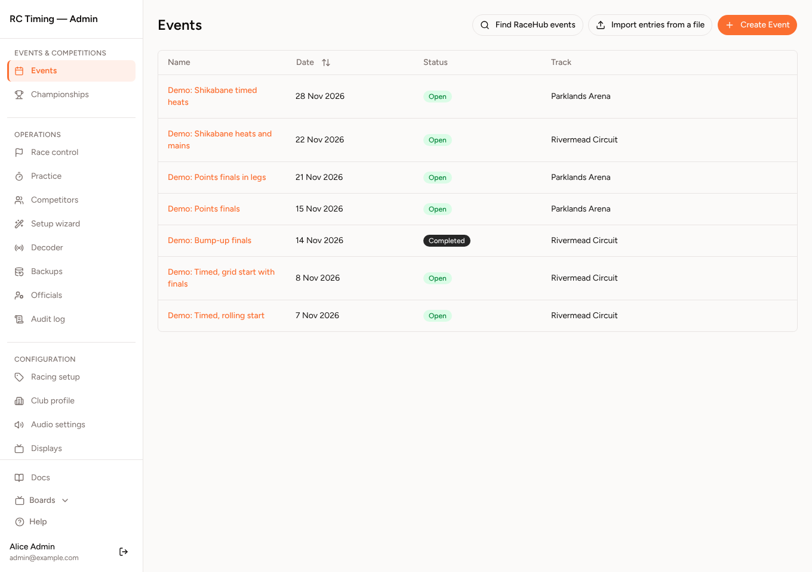
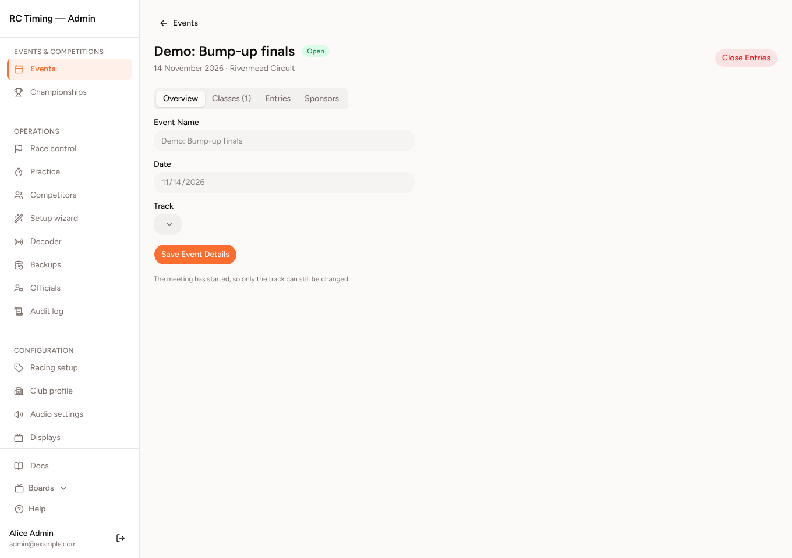
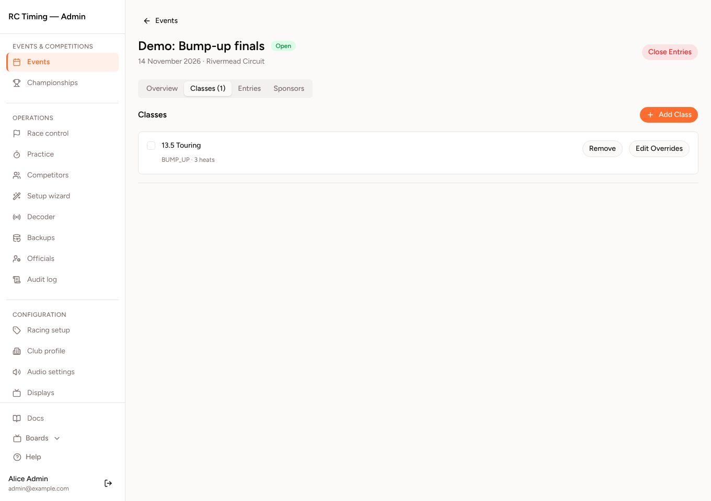
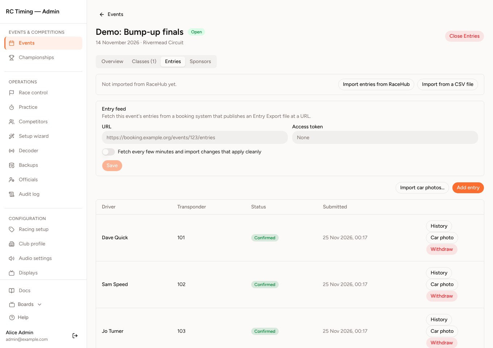
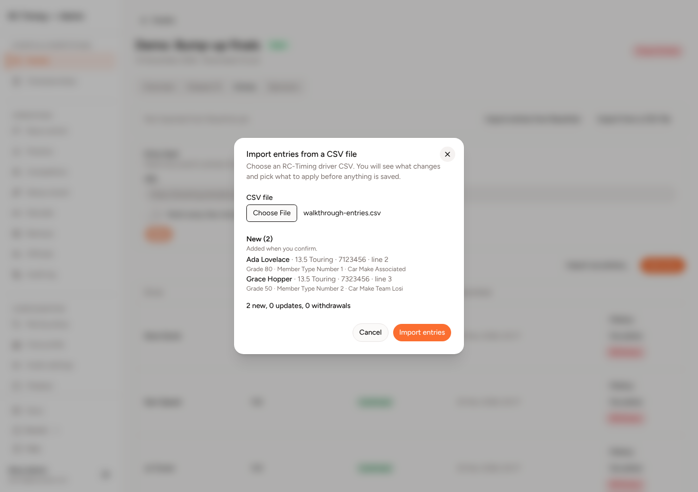
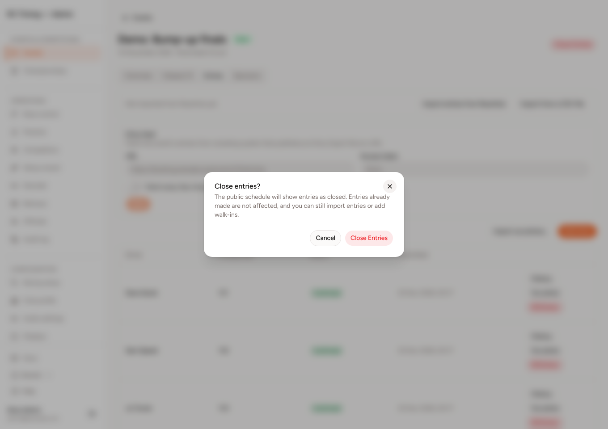
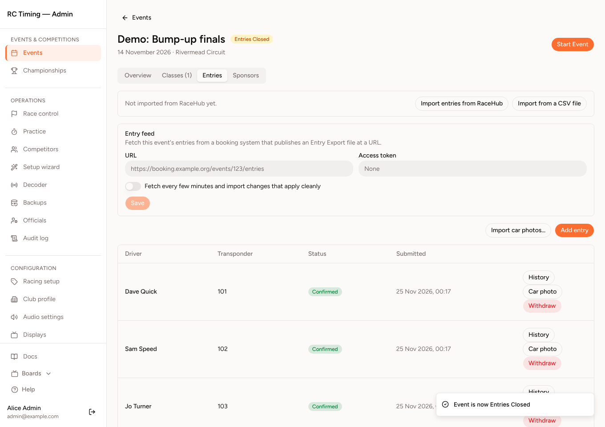
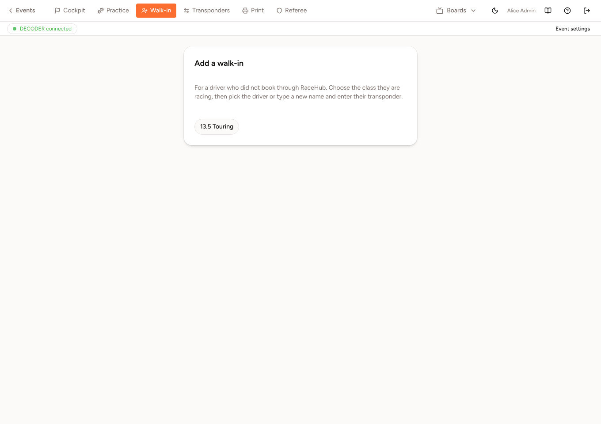
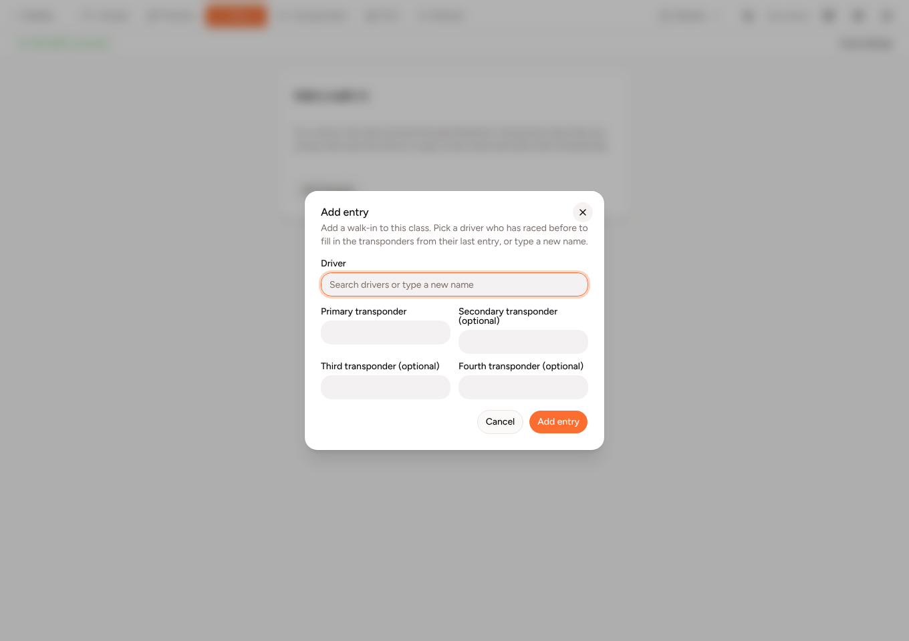

# 2. Get a meeting ready: entries and walk-ins

Part of the [walkthroughs](walkthroughs.md), which follow one imaginary club through a race day on the demo data.

**You need:** the club's classes and formats set up, and a list of entries from RaceHub or a spreadsheet. The demo club already has an event called **Demo: Bump-up finals** with fourteen drivers.

1. Go to **Events**. The list shows every meeting and its state. **Create Event** starts a new one. **Find RaceHub events** lists the meetings RaceHub has released to timing, and **Take** creates one here.

   

2. Open the event. The **Overview** tab holds its name, date and track.

   

3. On the **Classes** tab, add each class that is racing and pick a format for it.

   

4. The **Entries** tab shows who is entered, with their transponder numbers. Fill it from whichever source you have: **Import entries from RaceHub** (an Entry Export file), **Import from a CSV file** (an RC-Timing driver list), an entry feed, or **Add entry** by hand.

   

5. A CSV import shows you what it would change before anything is saved. Check the list, then press **Import entries**. Nothing is saved if you press Cancel. The RaceHub route works the same way: its file is checked, previewed, then applied.

   

6. When the entries are in, press **Close Entries** on the event page. The public schedule then shows entries as closed. You can still add walk-ins afterwards.

   

7. On the day, press **Start Event**. The event is now In Progress and appears under **Race control**.

   

**A driver who turns up without booking:** open **Race control**, choose the event, then **Walk-in**. Pick the class.

Choose a driver who has raced before, to bring their transponders across, or type a new name, then enter the transponder number and press **Add entry**. Do this before you generate rounds: once a race has started the run order can no longer be regenerated.

---

[← 1. First run: set up a new club](walkthrough-1-first-run.md) · [All walkthroughs](walkthroughs.md) · [3. Run qualifying and the finals →](walkthrough-3-qualifying-and-finals.md)
