# 3. Run qualifying and the finals

Part of the [walkthroughs](walkthroughs.md), which follow one imaginary club through a race day on the demo data.

**You need:** the event In Progress ([walkthrough 2](walkthrough-2-entries-and-walk-ins.md)) and the decoder connected. The bar at the top of race control shows **DECODER connected** in green.

1. Open **Race control** and choose the event. A new event has no races yet.

   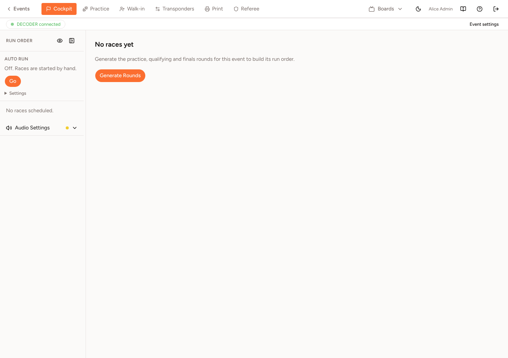

2. Press **Generate Rounds**. Say how many practice and qualifying rounds you want and how many finals each class has, then press **Generate Rounds** again. This walkthrough uses one practice round and one qualifying round to stay short; a real meeting usually has three qualifiers.

   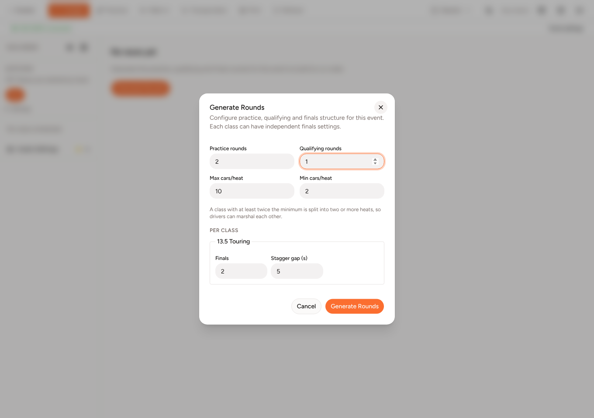

3. The run order appears down the left, with the next race marked **NEXT**. Select a race to work on it.

   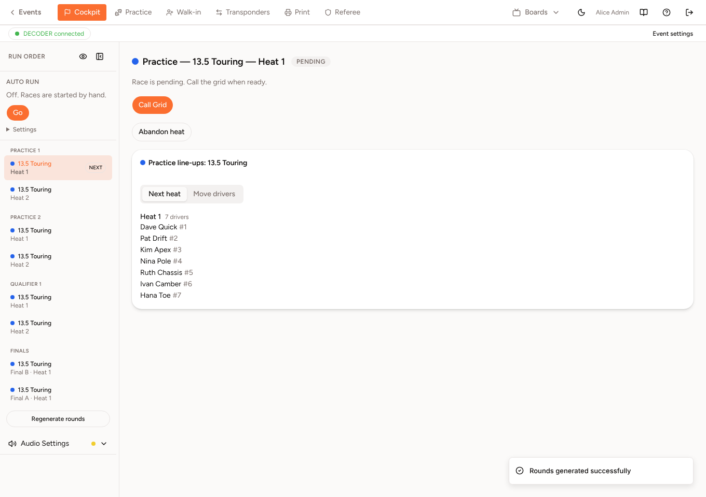

4. Press **Call Grid**. The drivers for that heat are listed. The **Warm-up** column shows which transponders the decoder has seen since the grid was called, so a flat battery or a missing transponder can be fixed before the start.

   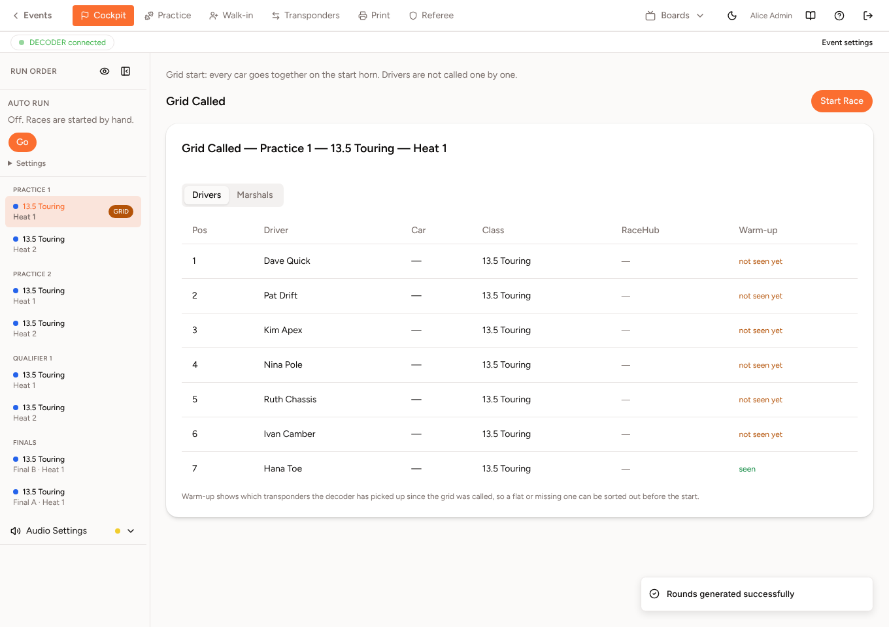

5. Press **Start Race**. Live timing shows each car's laps, last and best lap and the gap to the car ahead. A **CLOSE** tag and a tinted row mean two cars are running close together.

   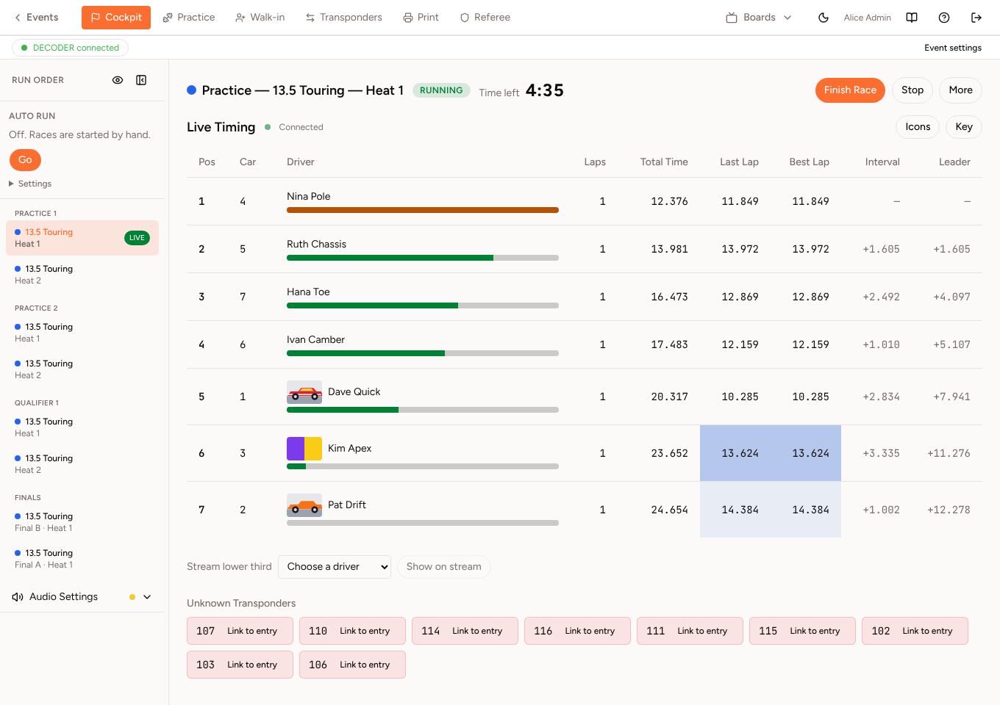

   **Auto run.** Starting a race by hand switches **Auto run** on for the event, so the next heat is called and started for you after the gap you set. Press **Stop** in the Auto run panel if you would rather start each race yourself.

6. **A transponder the system does not know** appears under **Unknown Transponders**. Press **Link to entry**, choose the driver it belongs to and press **Link Entry**. **Keep monitoring** leaves it for later.

   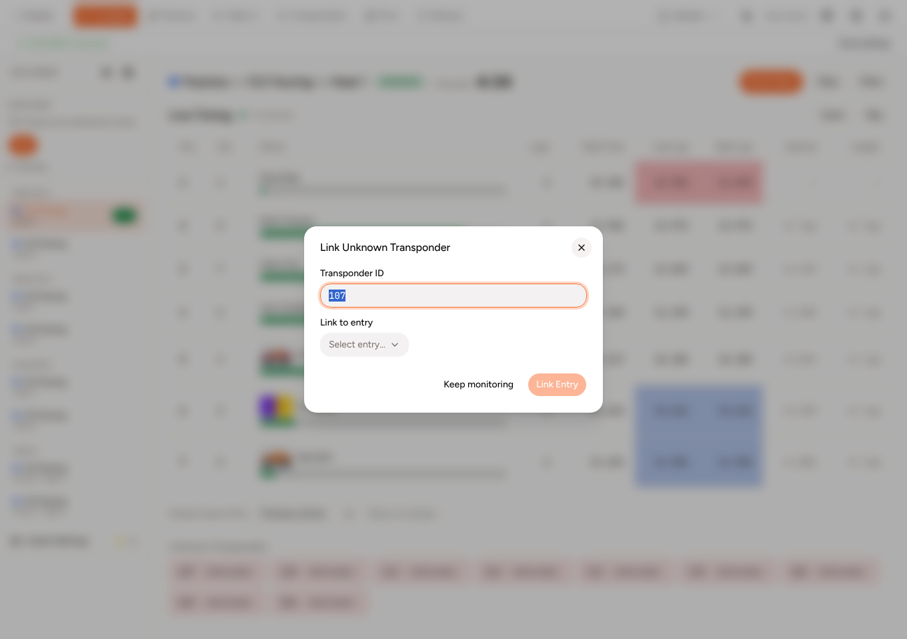

7. When the clock runs out and the cars have taken the flag, press **Finish Race**. The result is saved and shown. Pick the next race in the run order and repeat.

   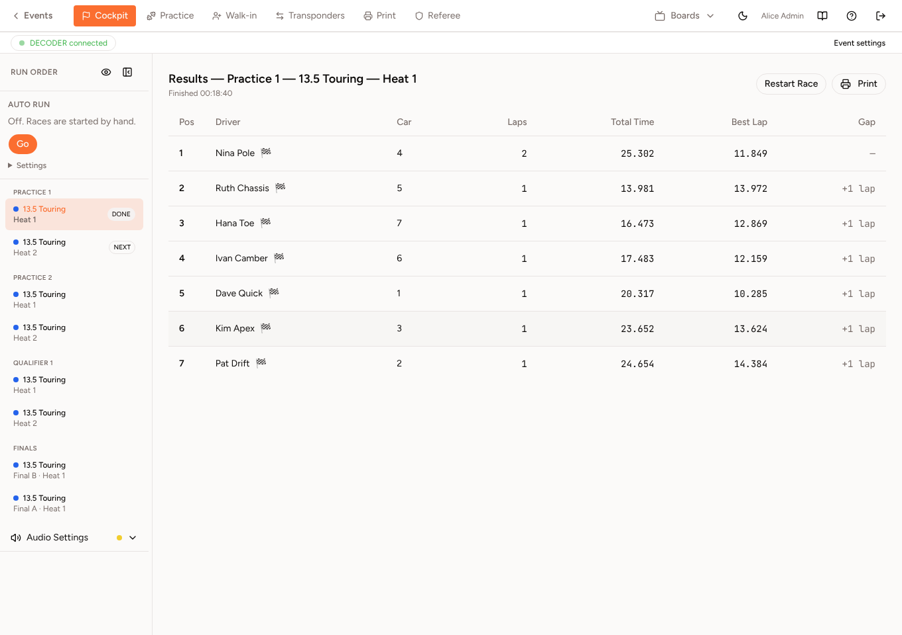

8. After the last qualifying heat, race control asks you to set the finals. Press **Calculate finals** for a class (or **Calculate finals for all classes**).

   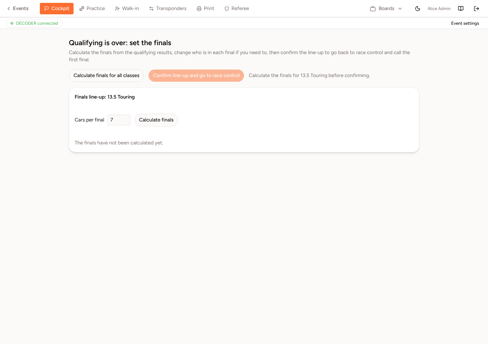

9. The page shows who is in each final and the qualifying table behind it. Use **Move to…** or the arrows to change someone's place. Then press **Confirm line-up and go to race control**.

   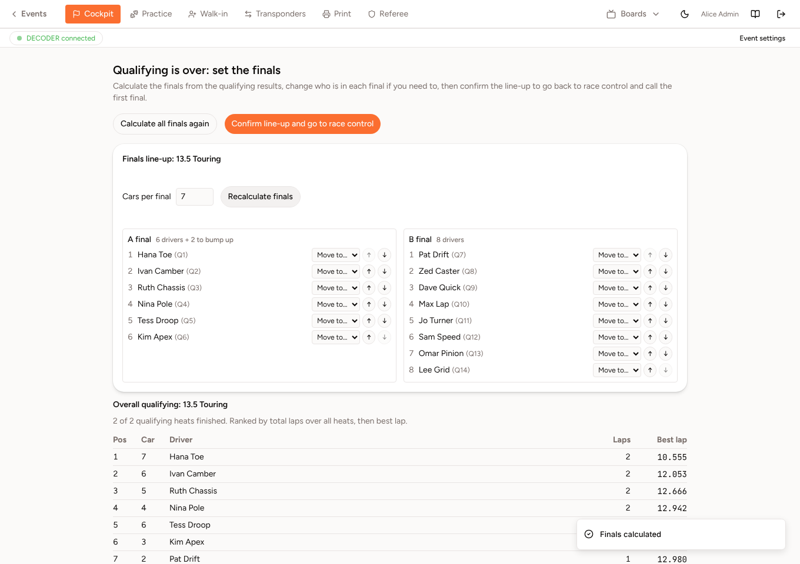

10. Run the finals in the same way, lowest final first. With a **Bump Up** format, the best finishers of each lower final move up into the final above when it finishes, and race control tells you so. Check the grid before you start the next final.

    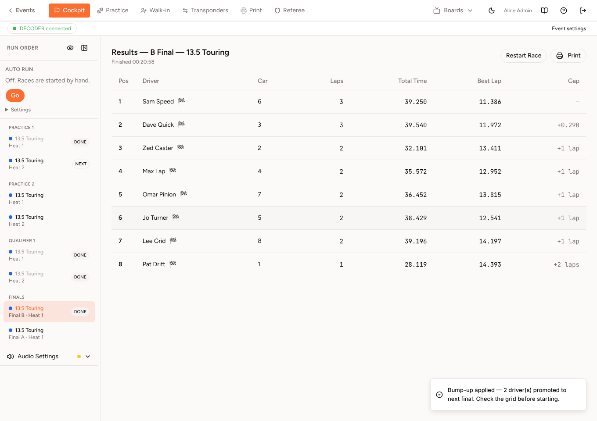

11. The result of the last final is the winner's result.

    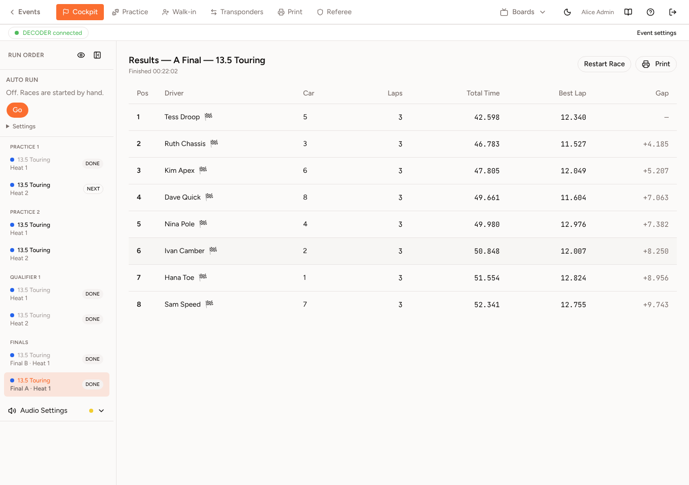

If a race goes wrong, **More** beside **Stop** offers **Restart** and **Abandon**. [race-types.md](race-types.md) explains how each race type starts and ends.

---

[← 2. Get a meeting ready: entries and walk-ins](walkthrough-2-entries-and-walk-ins.md) · [All walkthroughs](walkthroughs.md) · [4. Referee: incidents and penalties →](walkthrough-4-referee.md)
