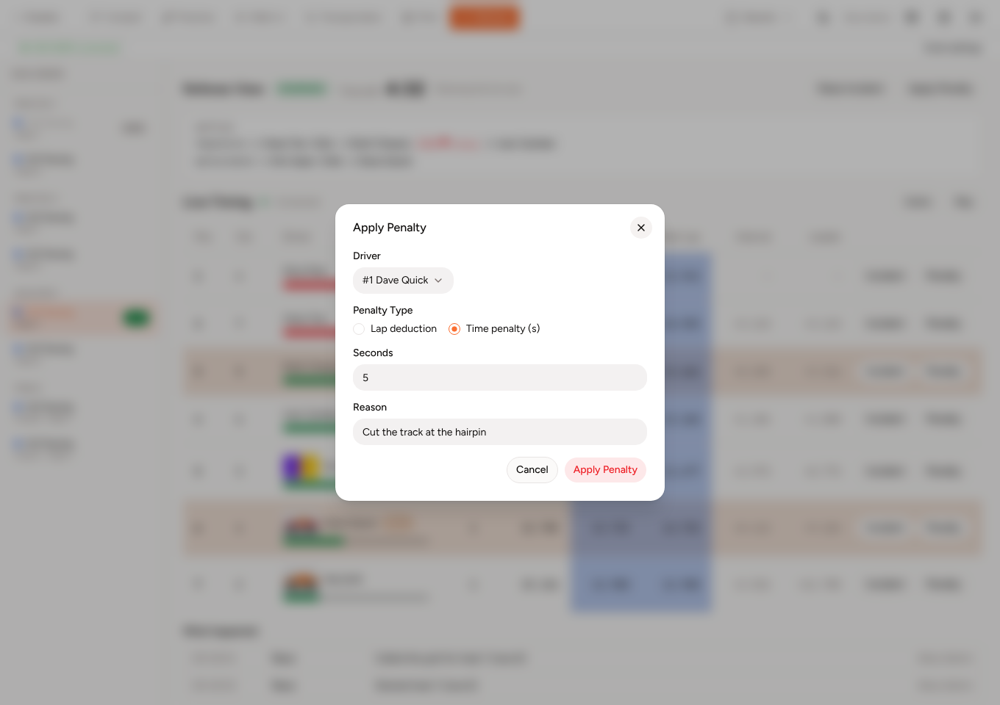
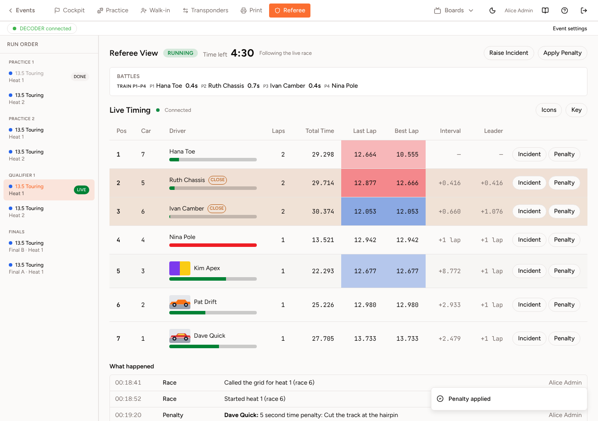

# 4. Referee: incidents and penalties

Part of the [walkthroughs](walkthroughs.md), which follow one imaginary club through a race day on the demo data.

**You need:** a race running, and an account with the referee role (the demo admin has it).

1. Open **Referee** in the top bar. It follows the live race and adds a **Battles** strip, a button beside each driver, and a log of **What happened**.

2. **Raise Incident** records something you saw, such as contact or a shortcut, without changing the result. **Apply Penalty** changes it.

3. To penalise, press **Apply Penalty** (or **Penalty** beside the driver). Pick the driver, choose **Time penalty (s)** or **Lap deduction**, enter the amount and a reason, and press **Apply Penalty**.

   

4. The penalty is added to the result at once and appears in the log with your name and the reason.

   

---

[← 3. Run qualifying and the finals](walkthrough-3-qualifying-and-finals.md) · [All walkthroughs](walkthroughs.md) · [5. Swap a transponder on the day →](walkthrough-5-transponder-swap.md)
