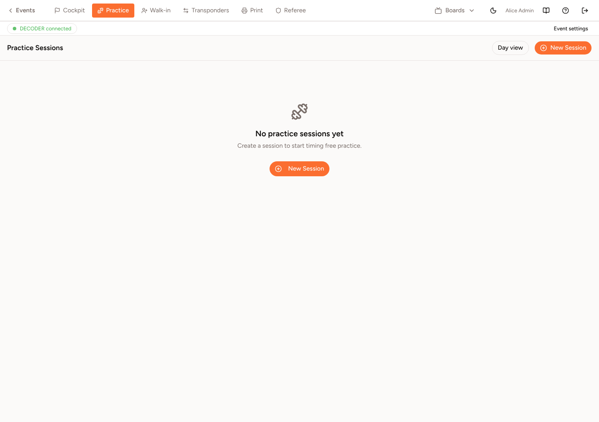
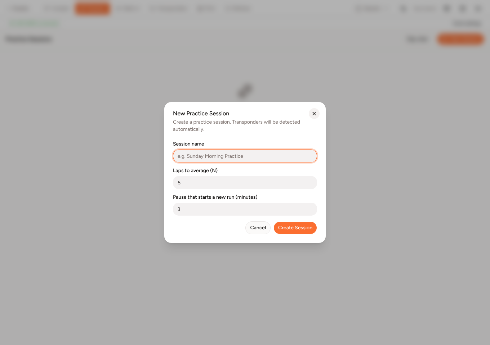
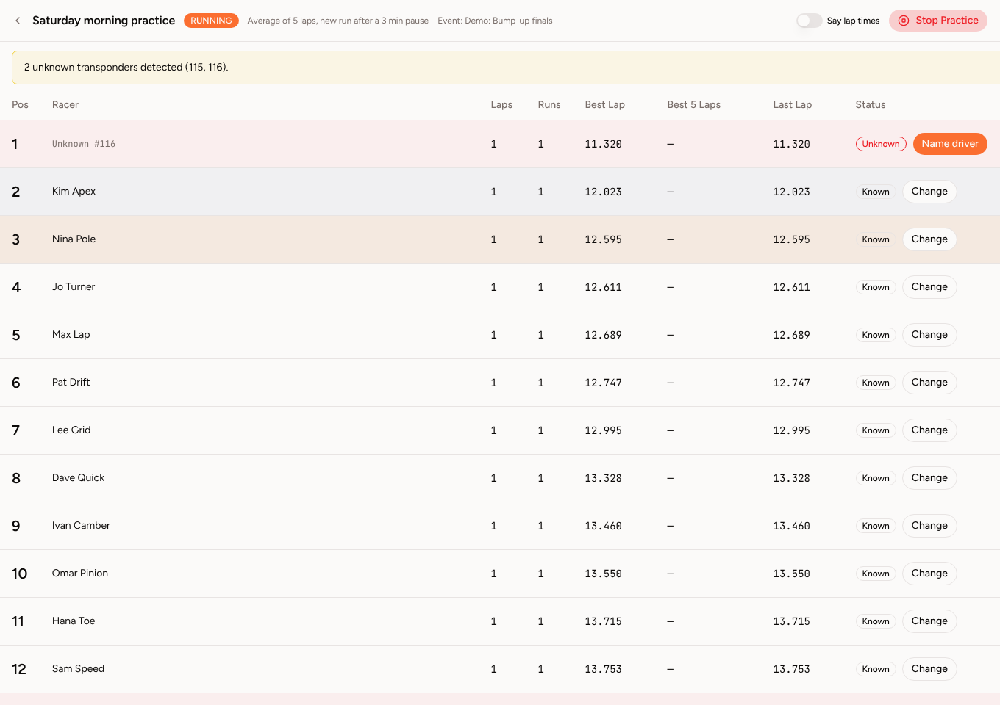

# 6. Open practice

Part of the [walkthroughs](walkthroughs.md), which follow one imaginary club through a race day on the demo data.

**You need:** the decoder connected. Open practice runs outside any heat: one long session, with laps grouped into runs by a pause.

1. Choose **Practice** in the top bar of race control (or **Practice** in the admin sidebar).

   

2. Press **New Session**. Name it, say how many laps to average, and how long a pause starts a new run.

   

3. Press **Start Practice**. Every transponder the decoder sees appears with its laps, best lap and best average over the number of laps you chose. A driver whose transponder is not on an entry shows as **Unknown**: press **Name driver** to give them a name, or **Change** to correct one.

   

4. Press **Stop Practice** when you have finished. The session is kept, and a day view lists every session.

---

[← 5. Swap a transponder on the day](walkthrough-5-transponder-swap.md) · [All walkthroughs](walkthroughs.md) · [7. Finish the meeting: results and printing →](walkthrough-7-results-and-printing.md)
