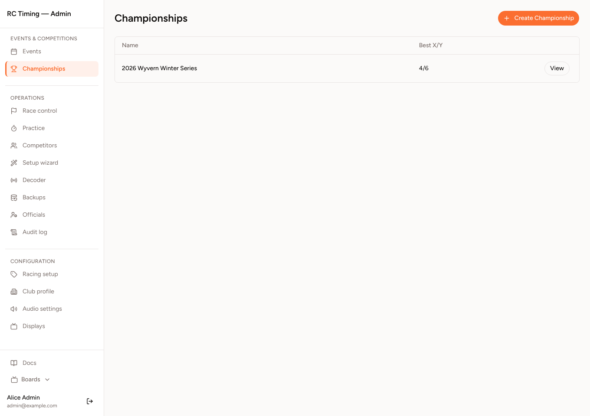
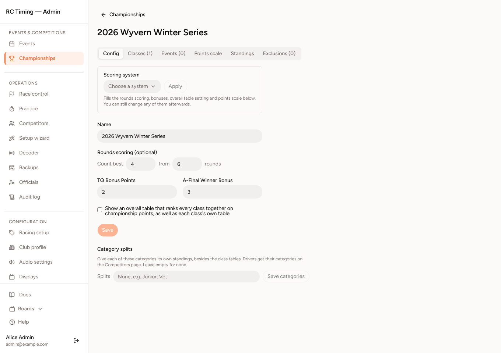
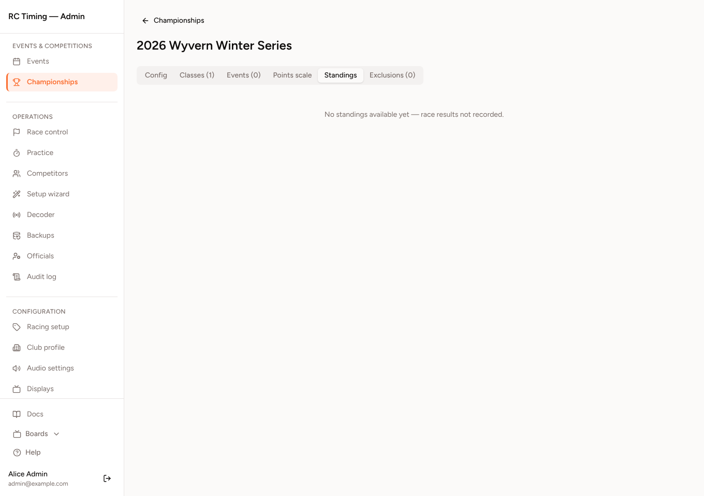

# 8. Championships

Part of the [walkthroughs](walkthroughs.md), which follow one imaginary club through a race day on the demo data.

A championship adds up results from several events with a best-X-from-Y rule and a points scale. [scoring.md](scoring.md) explains the rules.

1. Open **Championships**. Each series shows its name and its best-X-from-Y rule.

   

2. Open one. **Config** holds the best-X-from-Y rule and the bonus points, then there are tabs for **Classes**, **Events**, **Points scale**, **Standings** and **Exclusions**. A **Scoring system** picker at the top fills the rules from a saved set.

   

3. **Standings** are worked out from the saved results each time, so a corrected result changes them at once.

   

4. The standings are also public, at `/championships/` followed by the championship's number.

---

[← 7. Finish the meeting: results and printing](walkthrough-7-results-and-printing.md) · [All walkthroughs](walkthroughs.md) · [9. Put it on screens →](walkthrough-9-screens.md)
