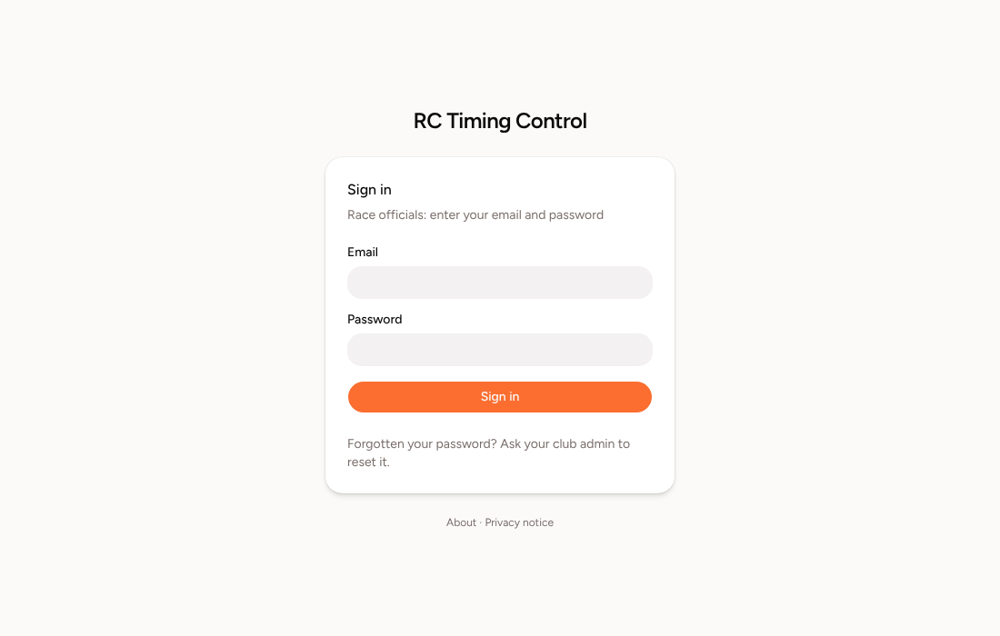
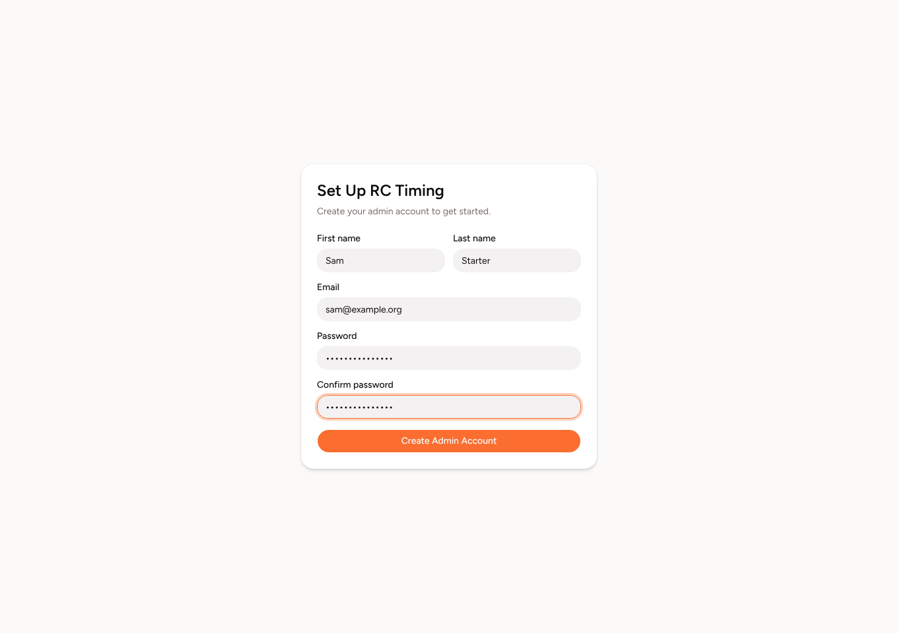
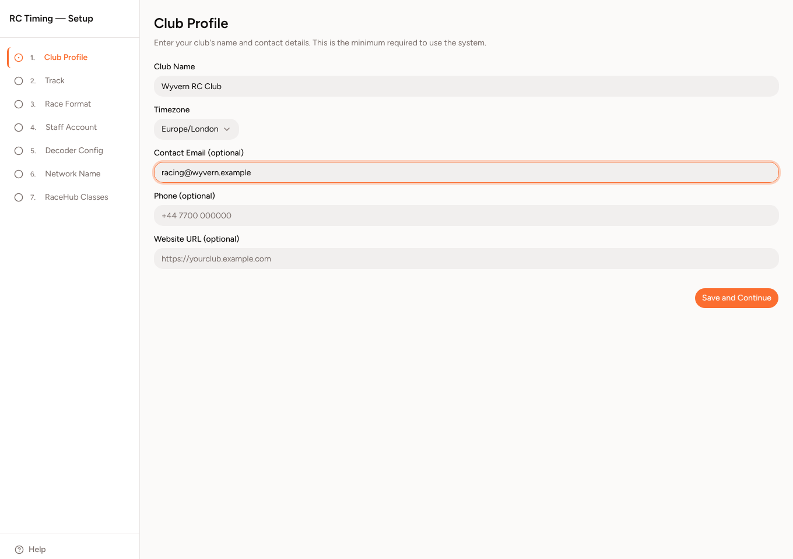
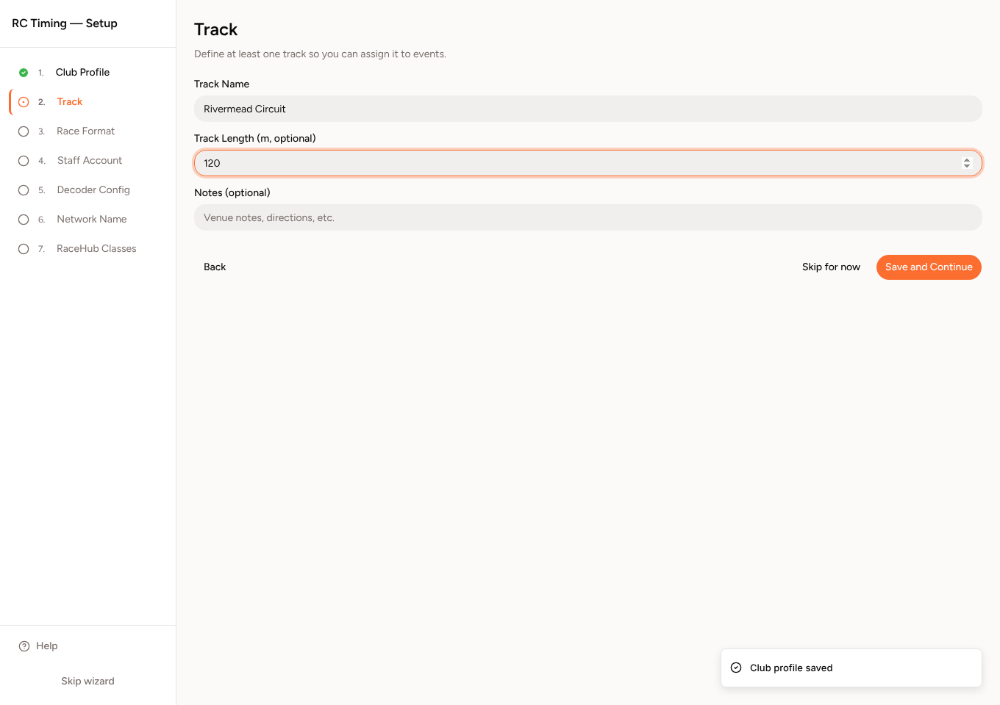
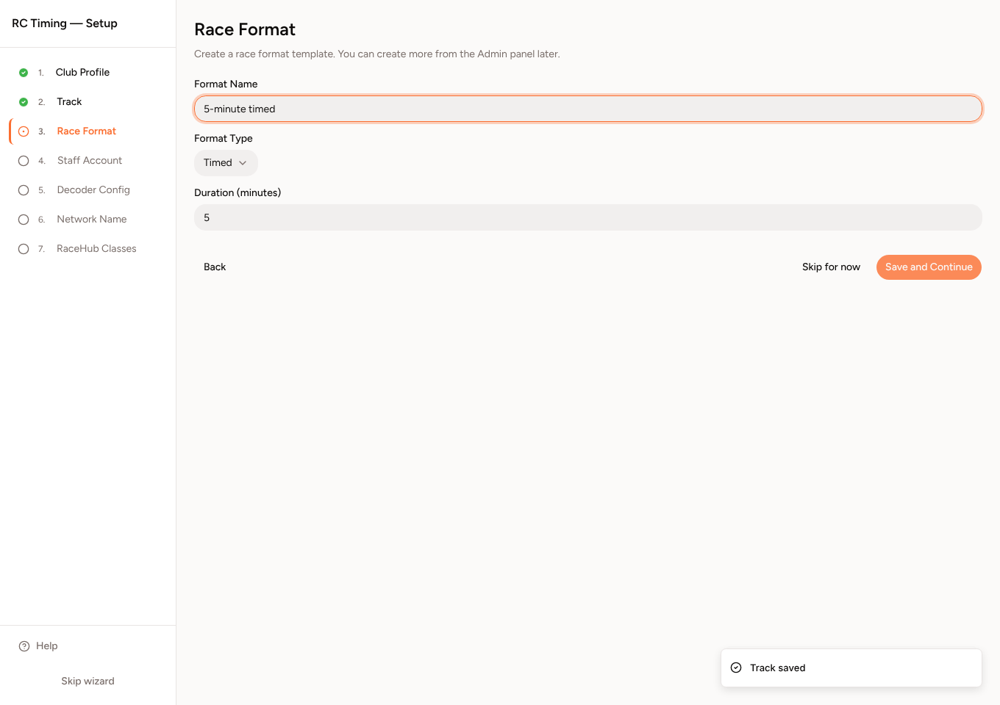
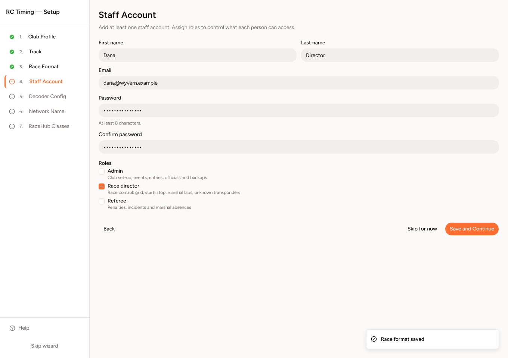
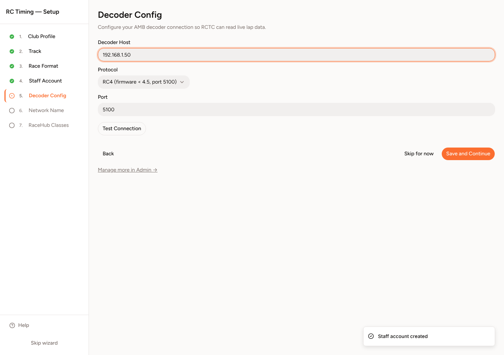
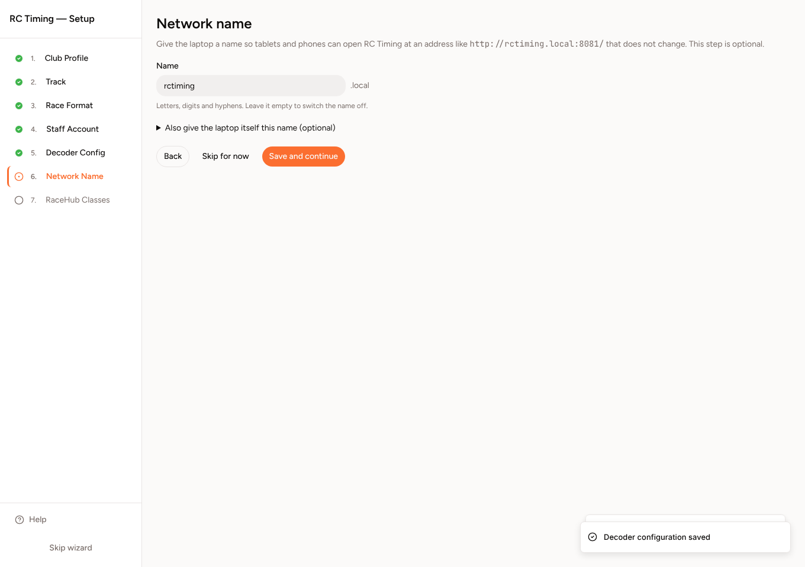
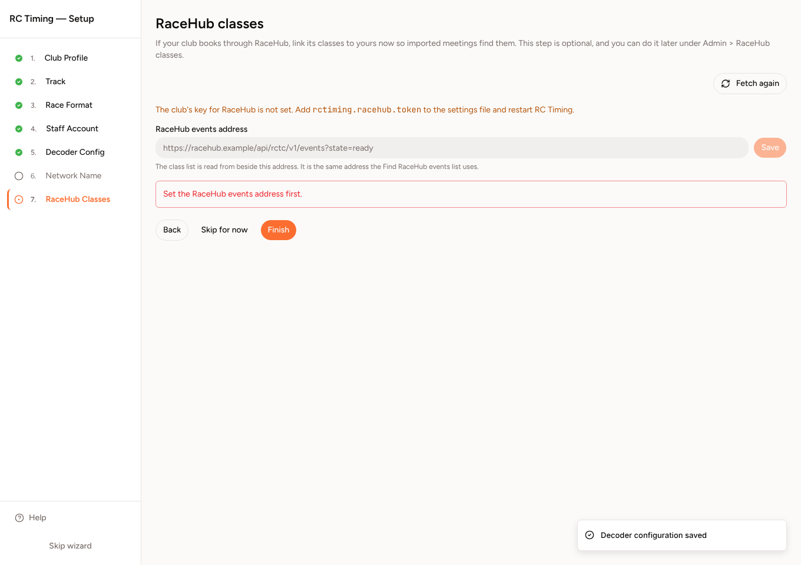
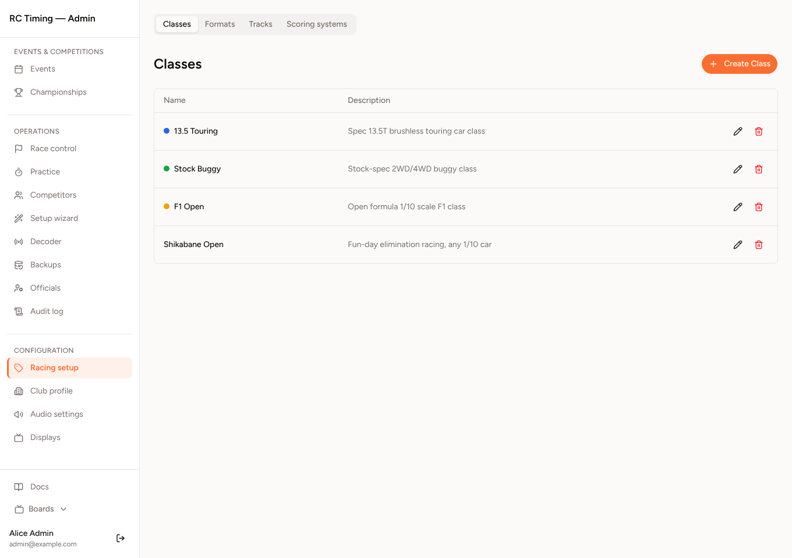

# 1. First run: set up a new club

Part of the [walkthroughs](../walkthroughs.md), which follow one imaginary club through a race day on the demo data.

**You need:** RCTC installed on the laptop ([installing.md](../installing.md)) and the decoder's address if you have it.

1. Open **http://localhost:8080** on the laptop. Once the club is set up this address shows the sign-in page, and only officials can sign in.

   

   A new install asks you to create the first administrator. This account can do everything, so use a real name and a password you will remember.

   

2. The setup wizard follows. The list on the left shows the seven steps and ticks them off. **Club profile** asks for the club's name and time zone (the contact details are optional).

   

3. **Track** takes the track's name and, if you know it, its length. You can add more tracks later.

   

4. **Race format** makes your first format, which says how a race is run. Start with a plain timed race. [race-types.md](../race-types.md) describes the others.

   

5. **Staff account** adds a second official, for example the race director. Tick their roles. Racers never sign in, so this is only for the people who run the meeting.

   

6. **Decoder** takes the decoder's address. Leave the protocol on RC4 for firmware below 4.5 and press **Test Connection** if the decoder is on the network. You can skip this and do it later under **Decoder** in the sidebar.

   

7. **Network name** gives the laptop a name such as `rctiming.local`, so phones and tablets can use an address that does not change.

   

8. The last step links your classes to RaceHub's. Skip it if you do not use RaceHub.

   

Anything you skip can be done later from the sidebar. A club that rebuilds its laptop often can skip the wizard completely: [provisioning.md](../provisioning.md).

**Next:** add the classes your club races under **Racing setup**, then create a meeting ([walkthrough 2](2-entries-and-walk-ins.md)).

---

[All walkthroughs](../walkthroughs.md) · [2. Get a meeting ready: entries and walk-ins →](2-entries-and-walk-ins.md)
