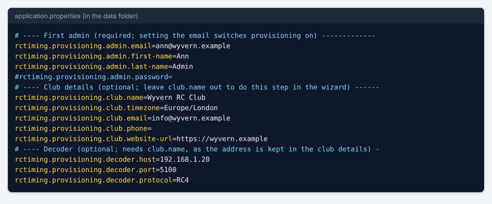
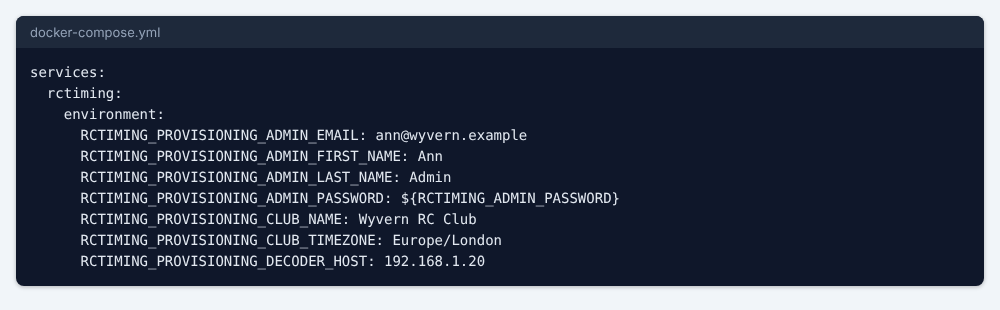
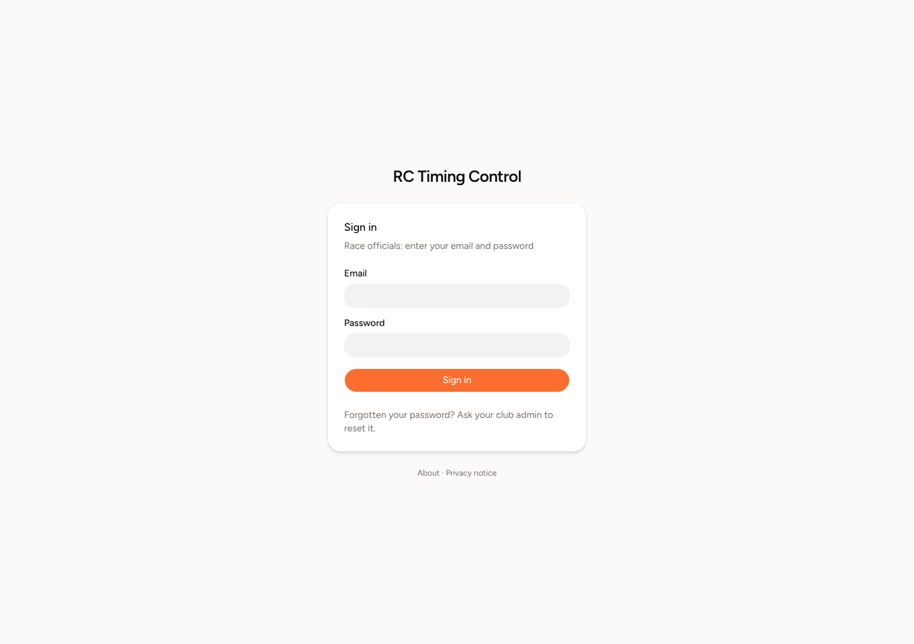
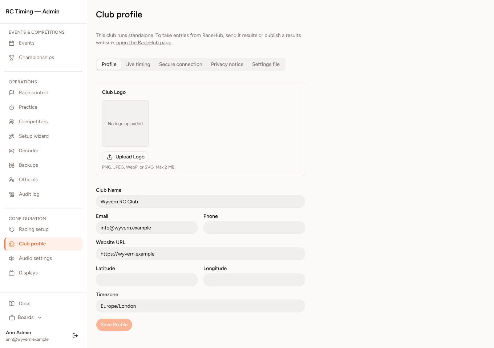
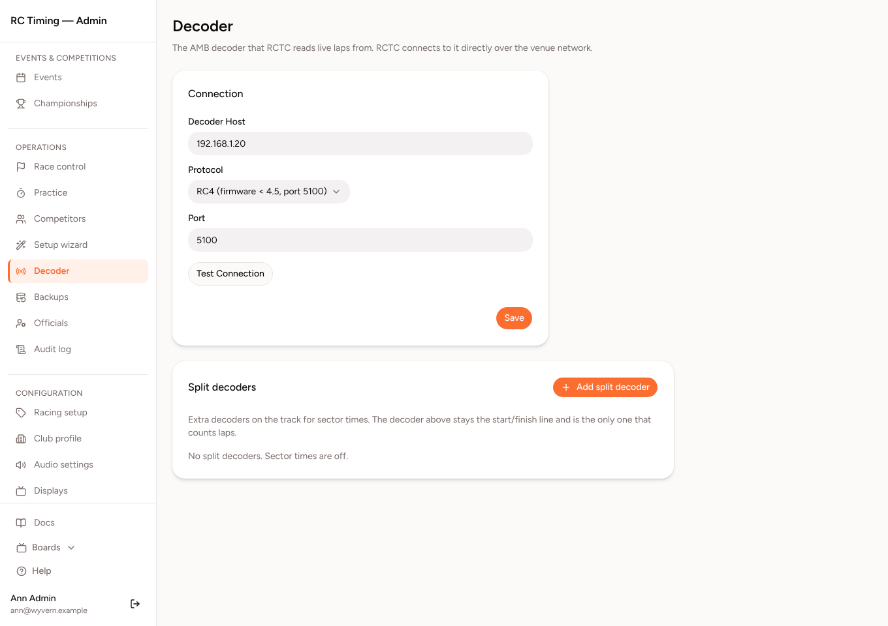
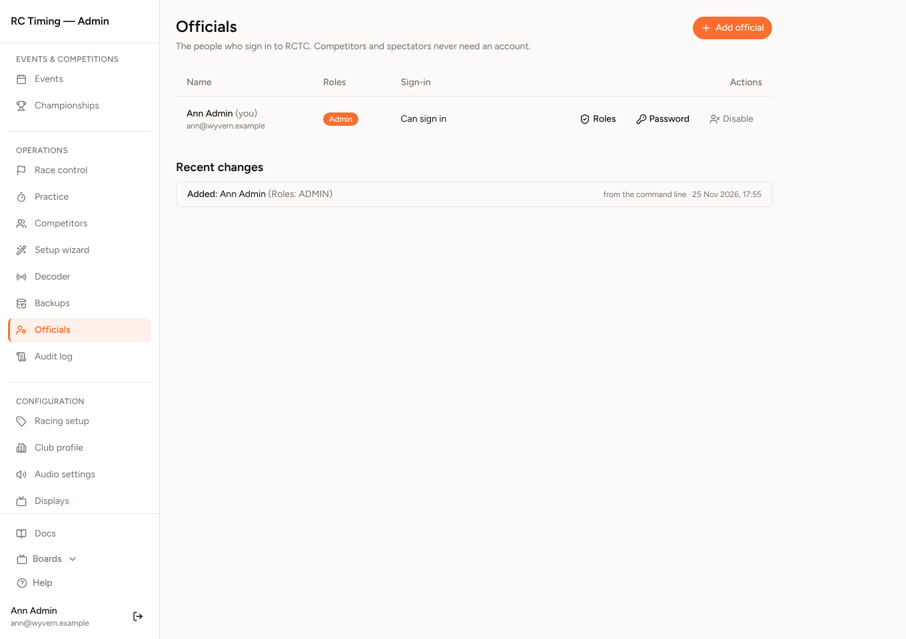

# 10. Set up from a config file

Part of the [walkthroughs](../walkthroughs.md), which follow one imaginary club through a race day on the demo data.

A club that rebuilds its laptop often, or runs the Docker image, can give the setup wizard's answers in advance. The first official, the club's details and the decoder's address go in a settings file or in environment variables, and the app skips the wizard the first time it starts. [provisioning.md](../provisioning.md) lists every setting; this page shows the steps and what you get.

**You need:** RCTC not yet set up (the database has no accounts), the first official's name, email and a password, and, if you have it, the club's details and the decoder's address.

1. Write the settings. Setting `admin.email` switches the feature on, and the password and both names are then needed. The club and decoder blocks are optional: leave `club.name` out to do the club step in the wizard afterwards. A complete annotated example to copy is `docs/examples/provisioning.example.properties` in the source.

   

2. Put them where the app reads them.

   - **Installed app (Windows, macOS, Linux):** save the file as `application.properties` in the data folder ([installing.md](../installing.md) says where that is), then start the service.
   - **Docker:** give each setting as an environment variable. Upper-case the name and replace the dots and dashes with underscores, so `rctiming.provisioning.admin.email` is `RCTIMING_PROVISIONING_ADMIN_EMAIL`. Keep the password in a `.env` file that is not kept in git.

     

     To use a settings file in Docker instead, mount it into the data folder and add `SPRING_CONFIG_ADDITIONAL_LOCATION: optional:file:/data/` to the environment, because the container does not look in the data folder by itself.
   - **Running the jar by hand:** use the environment variables, or start it with `--spring.config.additional-location=optional:file:/path/to/the/folder/`.

3. Start the app and open **http://localhost:8080**. The wizard does not appear: you land on the sign-in page, because the first official already exists. The settings are applied before the app accepts connections, so nobody on the network can complete the wizard first.

   

4. Sign in with the email and password from the settings. **Club profile** shows the name, time zone and contact details you gave.

   

5. **Decoder** shows the address, port and protocol, ready for **Test Connection**.

   

6. **Officials** lists the first administrator. Add the race director and the other officials here.

   

7. Take the password out of the file or the environment. It is only used to create the account, and the administrator can change it on their own page.

**Good to know**

- It applies only on a **first start**. Once an official exists the settings are ignored (the log says so), so editing the file later never changes a club that is already set up, and a restart never overwrites what officials changed in the app.
- If the settings are incomplete or invalid the app stops with a message naming the setting, rather than starting with an open wizard.
- To start again from the defaults, stop the app, move the database file out of the data folder (or use a new data folder, or `docker compose down -v`) and start it again.
- Tracks, race formats, classes and more officials are still added in the app, or by a RaceHub import. The RaceHub key can go in the same file as `rctiming.racehub.token`.

**Next:** add the classes your club races under **Racing setup**, then create a meeting ([walkthrough 2](2-entries-and-walk-ins.md)).

---

[← 9. Put it on screens](9-screens.md) · [All walkthroughs](../walkthroughs.md) · [11. Connect to RaceHub →](11-racehub.md)
