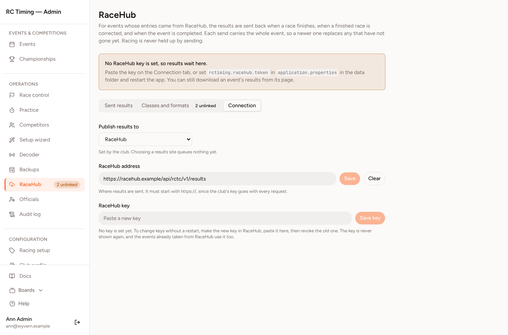
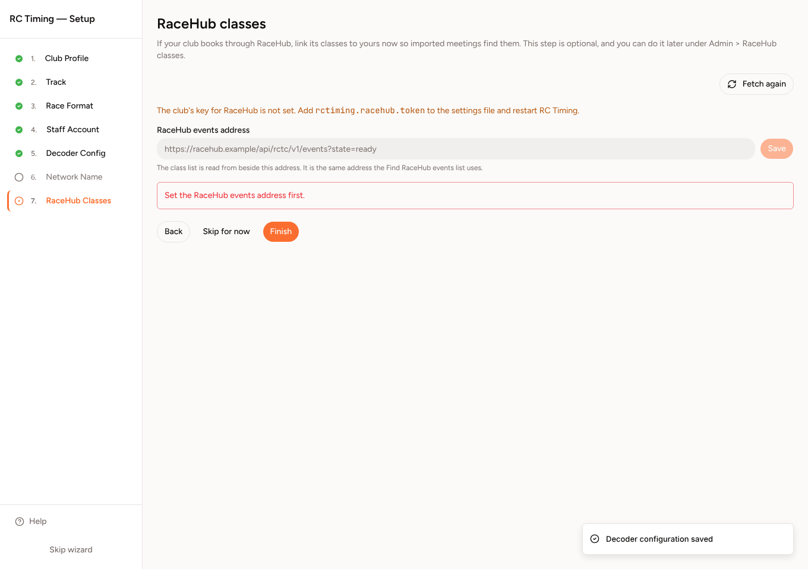
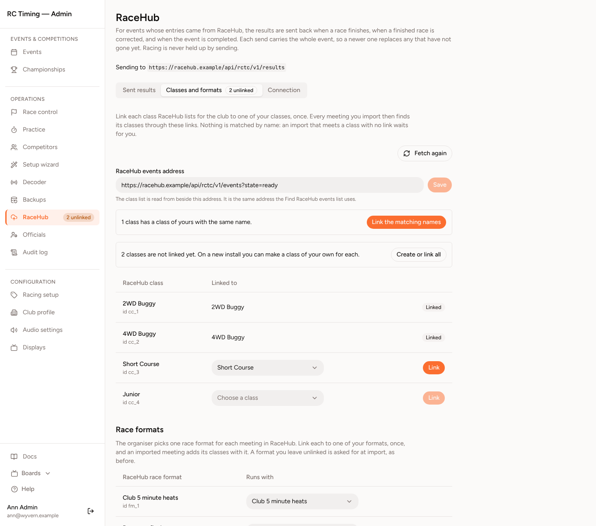
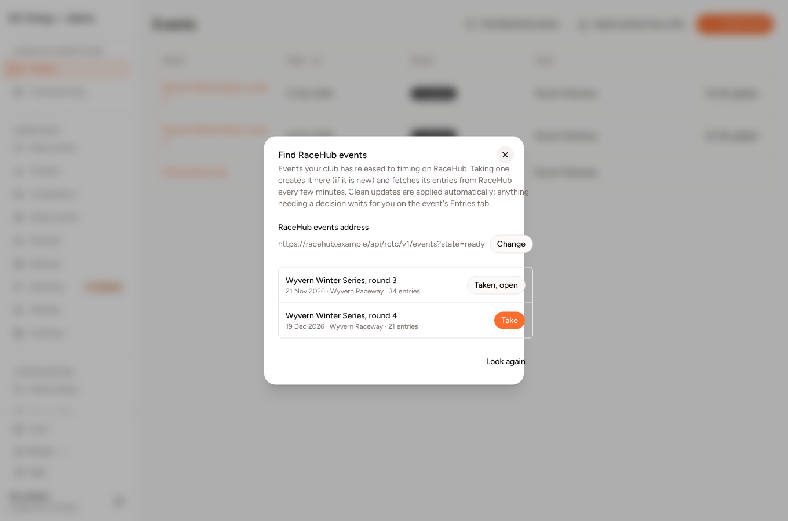
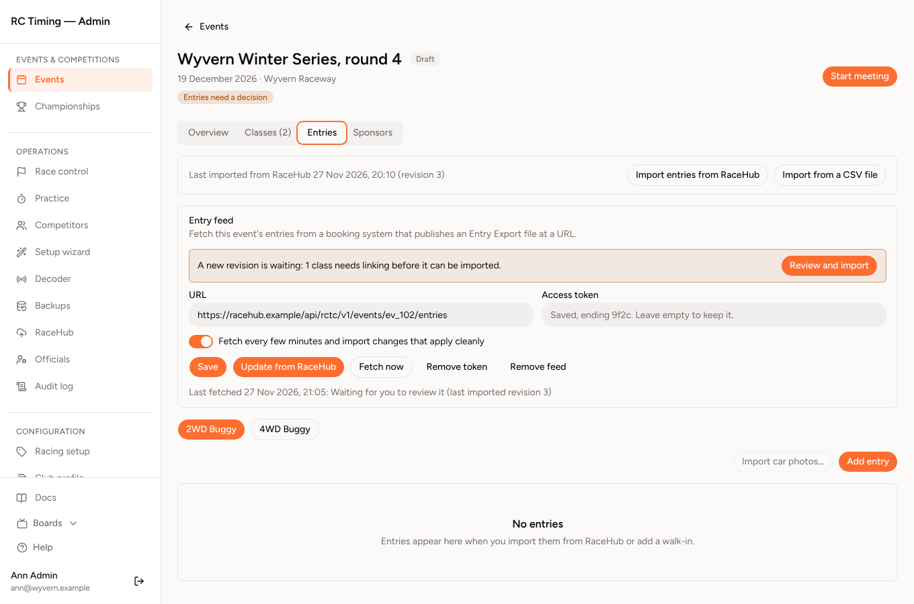
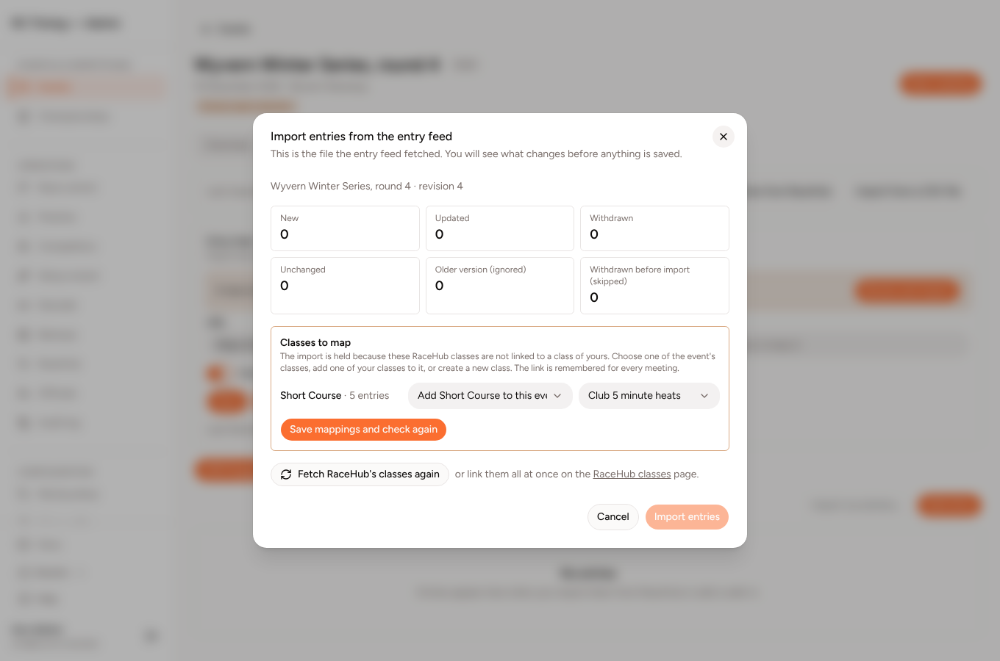
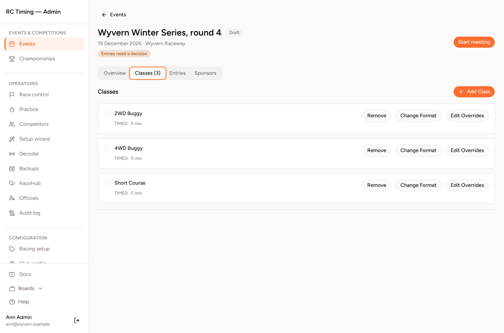
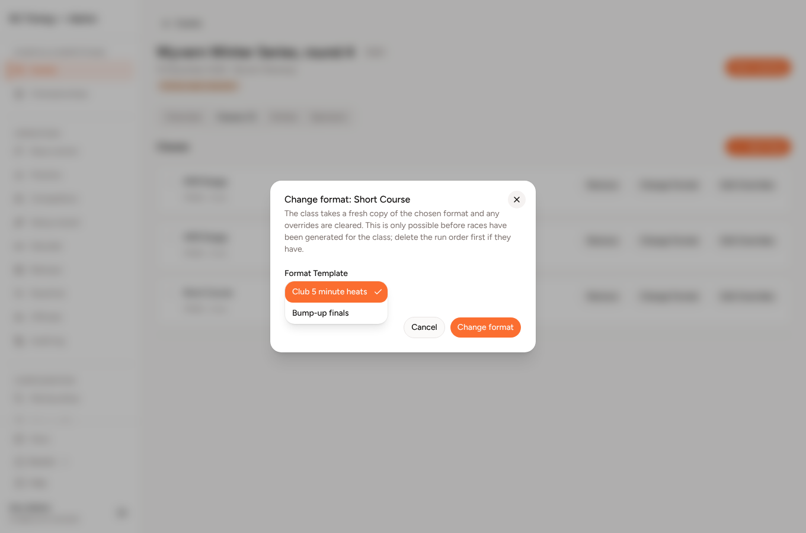
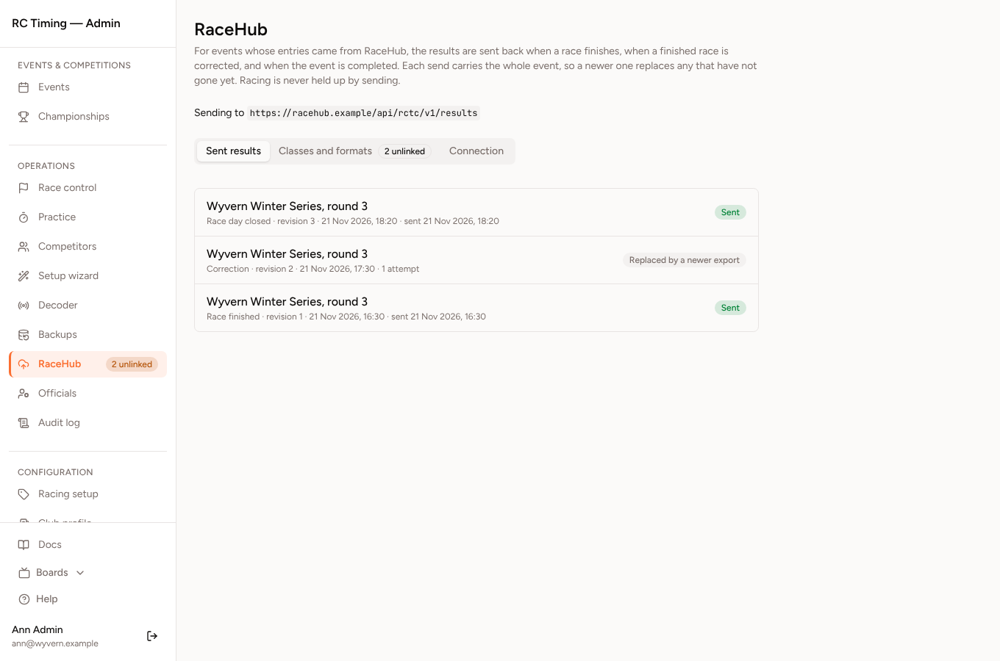
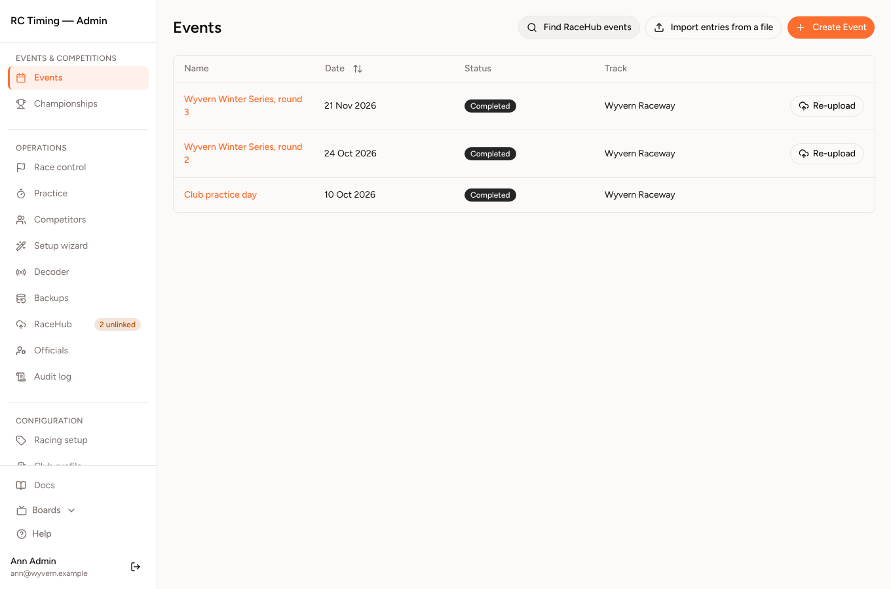

# 11. Connect to RaceHub

Part of the [walkthroughs](../walkthroughs.md), which follow one imaginary club through a race day on the demo data.

Wyvern RC Club takes bookings on RaceHub and times its meetings with RCTC. This walkthrough links the two: the club's key, its classes and formats, a meeting's entries, and the results going back. [racehub-integration.md](../racehub-integration.md) explains who owns what; this page shows the order to do things in.

**You need:** an administrator account in RCTC, a **club-level key** from RaceHub (one club per key, holding `entries:read` and `results:write`), and RaceHub's address. The laptop needs the internet while you do this, but not while racing.

## 1. Get the key

In RaceHub, make a key for the club and copy it. It is shown once. RaceHub's own guide covers where; RCTC only needs the text.

## 2. Give RCTC the key

There are two places, and either works.

- **The settings file.** Add these to `application.properties` in the data folder ([installing.md](../installing.md) says where it is), or the matching environment variables in Docker, then restart the app. This is how a [provisioned install](10-config-file.md) does it.

  ```properties
  rctiming.racehub.token=the-key-from-racehub
  rctiming.racehub.url=https://racehub.example
  ```

- **The admin page.** Open **Admin → RaceHub → Connection**. **RaceHub** is always in the admin menu, even for a standalone club; **Club profile** links to it too. Enter the **RaceHub address** (just the host, such as `https://racehub.example`; you set it once and results, **Find RaceHub events**, the class and format lists and imports all use it), paste the key into **RaceHub key** and press **Save key**. It applies at once, no restart.

  

Under the key, press **Test connection**. It checks the address and key you saved and lists each result:

- **RaceHub reachable**: the address answers like RaceHub. A typo, no internet or a certificate problem shows here.
- **Key can read entries**: RaceHub accepts the key and lets it list meetings (`entries:read`). It also tells you how many meetings are released to timing. A revoked, expired or mistyped key shows as refused (401); a key for another club or without the ability shows as refused (403).
- **Key can send results**: the key has `results:write`. The test sends an empty JSON object that RaceHub refuses after it has checked the key, so nothing is stored in RaceHub.

Each line says what to fix. Save the address or key first: the test uses what is saved, not what is typed in the box.

A key saved on this page is kept encrypted, is never shown again, and **overrides the settings file's key** until you press **Clear**. To rotate a key later, make the new one in RaceHub, paste it here, check **Find RaceHub events** (step 4) still lists your meetings, then revoke the old one in RaceHub.

## 3. Link the classes and formats once

In the first-run wizard this is the optional **RaceHub Classes** step (the key can wait: the wizard says to put it in the settings file or the RaceHub page afterwards).



To do it later, or to change links, open **Admin → RaceHub → Classes and formats**.



- **Link the matching names** links every class that has the same name as one of yours.
- **Create or link all** makes a class of your own for each one that is left. Handy on a new install.
- Otherwise pick a class in the row and press **Link**.
- Lower on the page, **Race formats** links each format RaceHub lists to one of your format templates. The organiser picks one format per meeting on RaceHub, and an imported meeting adds its classes with the linked format. A format you leave unlinked is asked for at import, as before.

Links are for the whole club and made once. Every meeting after that finds its classes through them, and a class is never matched by name when an entry arrives. The tab shows how many classes are still unlinked.

## 4. Find the meeting and take it

Open **Events** and press **Find RaceHub events**. The list shows the meetings the club has released to timing. Switch to **Open for sign-up** or **All upcoming**, and pick dates, to take a meeting early; **Update from RaceHub** on its Entries tab fetches the latest entries at any time.



Press **Take** next to a meeting. RCTC creates the event (name and date from RaceHub), sets up its entry feed, fetches the entries straight away and opens the event's **Entries** tab. A meeting already taken shows **Taken, open**.

## 5. Import the entries and choose the formats

After **Take**, the event's **Entries** tab shows the **Entry feed** and, when RaceHub has sent a file that needs you, a banner saying so. Press **Review and import**.



The preview counts what will change: new entries, updated ones, withdrawn ones and ones already up to date. Nothing is saved until you press **Import entries**. From then on the feed fetches by itself (every hour until the last week before the meeting, then every five minutes), changes that apply cleanly go in without you, and **Update from RaceHub** or **Fetch now** gets the latest straight away. Entries you added by hand as walk-ins are never touched.

### Choose a race format for each class

An event class runs to one race format, copied into the event when the class is added (editing the format template later does not change the event). The format for a class comes from the first of these that applies:

1. **Chosen in the import preview.** If an entry is in a class RCTC has no link for yet, the whole import is **held**: nothing is saved and nothing is placed by name. The preview lists the held class under **Classes to map**. Pick one of your classes for it (or add one of your classes to the event, or create a new class), and the same row shows its **race format**. It starts on the format that class last used, or on the format linked to RaceHub's format for the meeting (step 3); change it here if you want another. Then press **Save mappings and check again**.

   

2. **The meeting's linked format.** If RaceHub gives the meeting a race format and you linked it to one of yours on **Admin → RaceHub → Classes and formats**, every class the import adds starts on it.
3. **Your first format.** A class that has never been in an event, with no format given, starts on your first format template. Check it.

The class link is remembered for the whole club, so the next meeting needs no linking.

### Change a class's format later

Open the event's **Classes** tab. Each class shows its format (for example *TIMED, 5 min*).



- **Change Format** swaps the class to another format template. It takes a fresh copy of the template and clears any overrides, because they may not fit the new format.

  

- **Edit Overrides** changes a few settings of the current format for this event only, such as the race length, and keeps the format.
- A format can only be changed before races have been generated for the class. If the run order is already built, delete it first, change the format and generate it again. The entries, the class's RaceHub link and any combined race group stay as they are.
- This is all done in RCTC. It does not need RaceHub, and nothing is sent back to RaceHub when you change a format.

### Other things the import tells you

- A transponder number used twice in the event is accepted with a warning, because one competitor may race in two classes. A swap on the day refuses a number another competitor holds.
- A driver who agreed on RaceHub may bring a headshot and car photo; press **Fetch the pictures** on the import result to save them.
- Once the run order is built, new or changed entries wait for you to review them instead of arriving by themselves.

Then choose the track, check the entries are all there, and press **Start meeting**. Walk-ins are added in RCTC as always ([walkthrough 2](2-entries-and-walk-ins.md)).

## 6. Results go back

Race, correct and finish as normal ([walkthrough 3](3-qualifying-and-finals.md)). RCTC sends the event's results to RaceHub when a race finishes, when one is corrected and when you complete the event. The laptop can be offline: sends queue and go when the network is back. **Admin → RaceHub → Sent results** shows each one.



**Waiting to send** and **Failed, will retry** rows retry by themselves, and **Send now** tries one immediately.

To send an event again, for example after fixing a result, press **Re-upload** on its row in **Events** (administrators only, for events that came from RaceHub). It sends the whole event; RaceHub keeps the newest copy, so it is safe to repeat.



**Is the link alive?** When RaceHub is set up, race control's status bar (beside the decoder) shows **RACEHUB linked**. RCTC checks RaceHub once a minute with a light request, so the indicator also turns red, with **unreachable**, **key refused** or **problem**, if the internet drops or a key is revoked. Results still queue and the bar says how many are **waiting**; hover for the reason and when results last went. A club without a RaceHub address and key does not see it. Racing is never held up either way.

**Good to know**

- Without both an address and a key, results wait in the queue, and **Download results** on the event's page still gives you the file.
- Racing is never held up by sending, and the club keeps every lap and result locally whether or not RaceHub receives them.
- The same page's **Publish results to** choice can also publish a results site, for a club that wants results on the web without RaceHub.
- A club that does not use RaceHub can skip all of this: see "Using RCTC without RaceHub" in [racehub-integration.md](../racehub-integration.md).

**Next:** [Finish the meeting: results and printing](7-results-and-printing.md).

---

[← 10. Set up from a config file](10-config-file.md) · [All walkthroughs](../walkthroughs.md)
