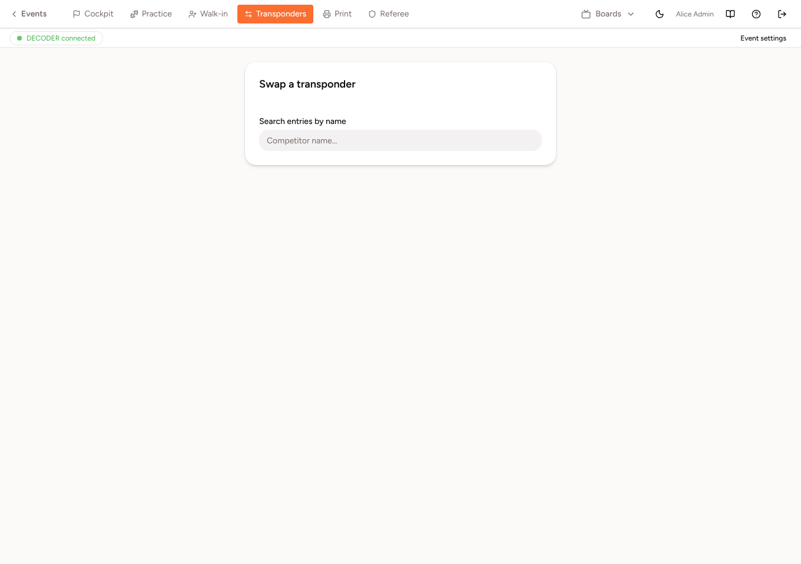
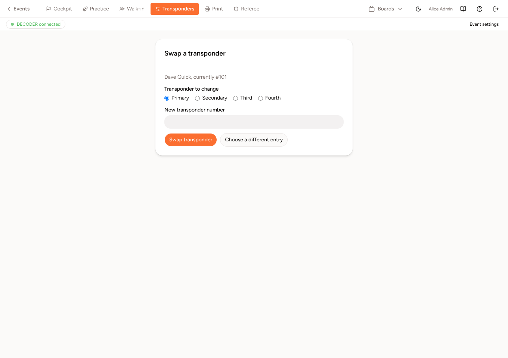

# 5. Swap a transponder on the day

Part of the [walkthroughs](../walkthroughs.md), which follow one imaginary club through a race day on the demo data.

**You need:** the driver's entry in the event. A car's transponder is replaced, for example after a flat battery, by changing it on the entry, and the change is written to the audit log. Make the change before the driver's race is called or after it has finished: a transponder is never changed during a race.

1. Open **Race control**, choose the event, then **Transponders**. Type the driver's name.

   

2. Choose the driver, pick which transponder to change (**Primary**, **Secondary**, **Third** or **Fourth**), type the new number and press **Swap transponder**.

   

A number that another driver in the event already holds is refused. If one driver uses the same transponder in two classes, RCTC accepts it with a warning, and a number that matches more than one entry in the running race goes to the referee rather than being credited to the wrong car.

---

[← 4. Referee: incidents and penalties](4-referee.md) · [All walkthroughs](../walkthroughs.md) · [6. Open practice →](6-open-practice.md)
