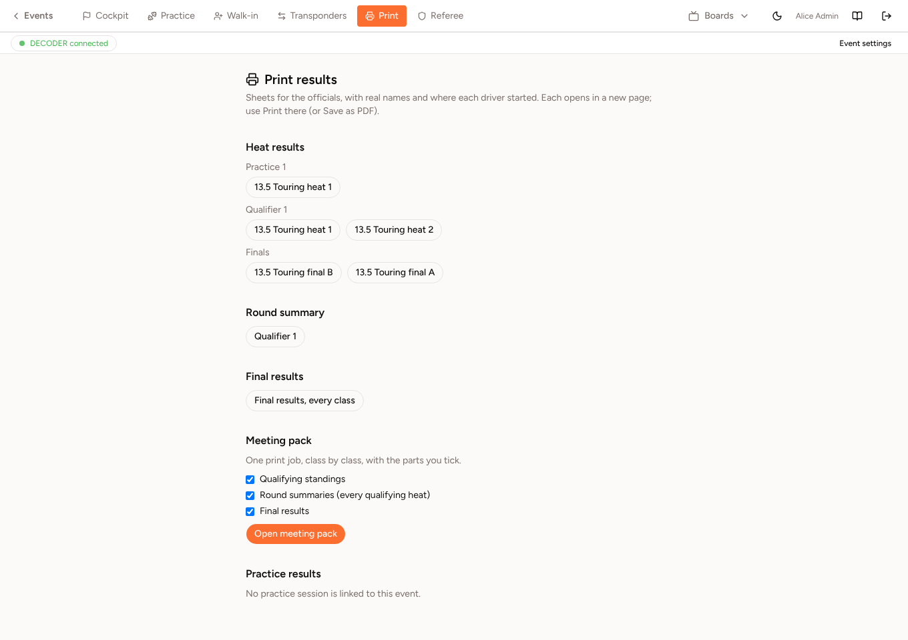
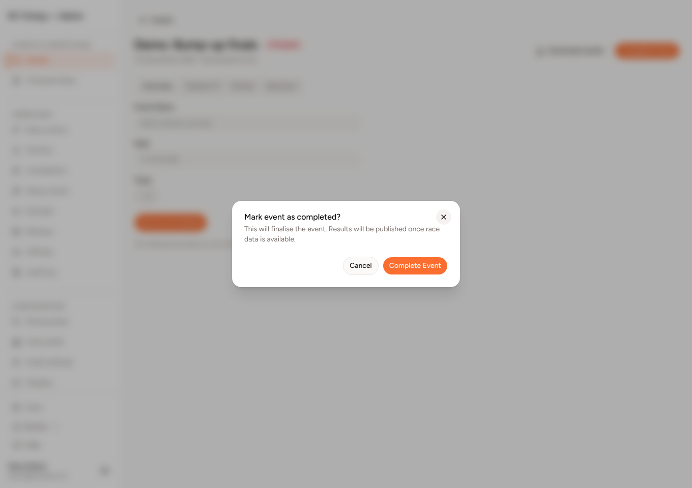
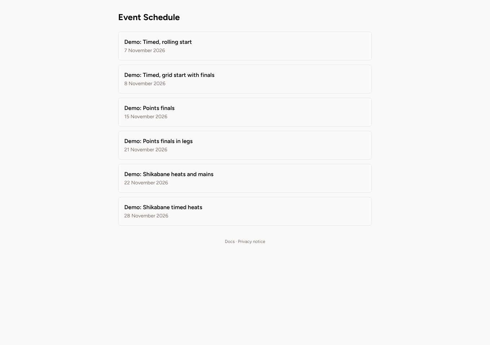
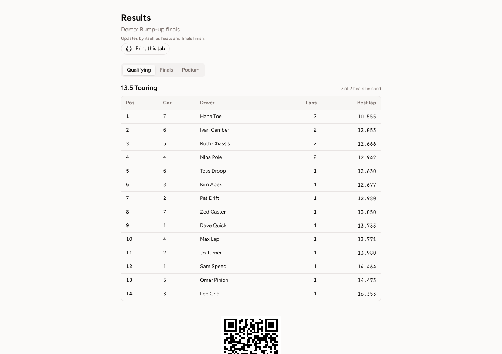
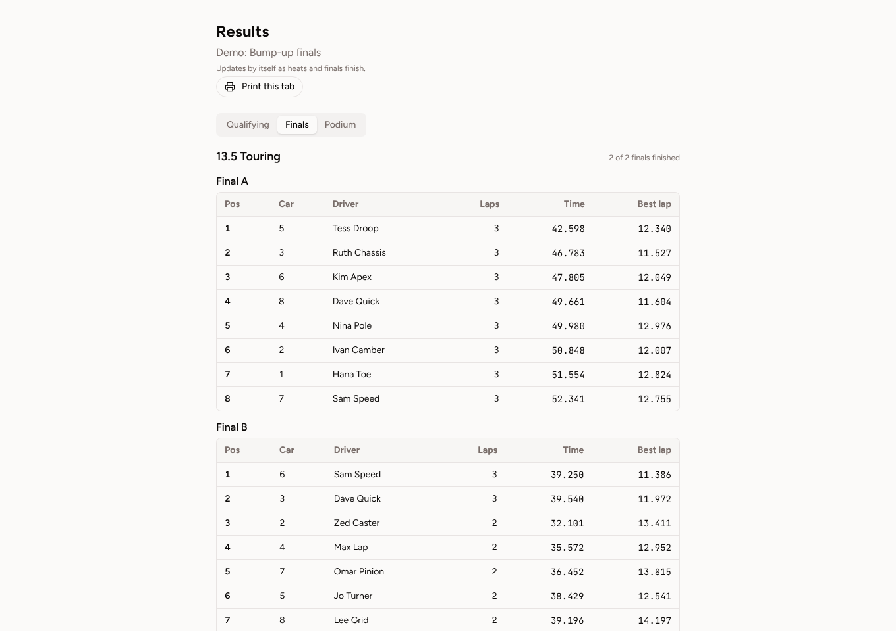
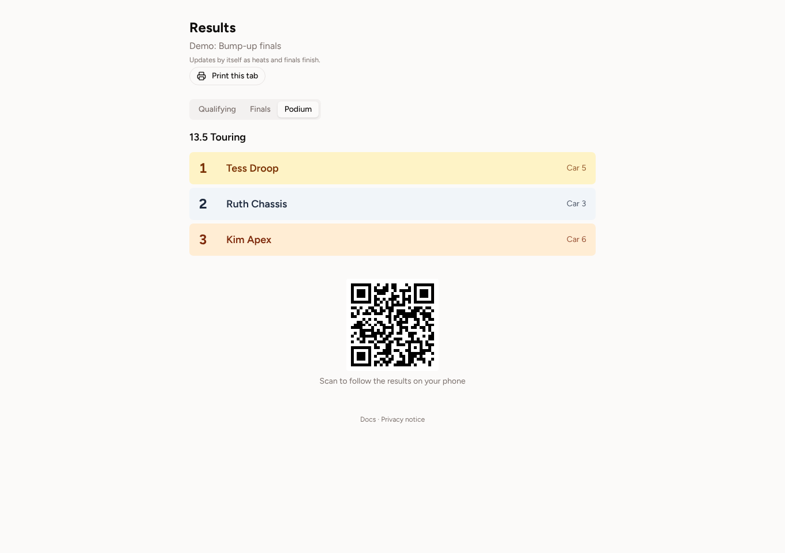

# 7. Finish the meeting: results and printing

Part of the [walkthroughs](../walkthroughs.md), which follow one imaginary club through a race day on the demo data.

1. Open the **Print** page for the event. It has a sheet for each heat, a summary for each round, the final results and a **Meeting pack** that prints the parts you tick in one go. Each opens in a new page; use the browser's Print, or Save as PDF.

   

2. When every race is done, open the event and press **Complete Event**. This closes the race day, takes a backup and sends the results to RaceHub if the event came from there.

   

3. The public pages need no sign-in. **Events** at `/events` is the schedule.

   

   Anyone on the venue network can read the results without signing in, at `/results` on the laptop's address. The page updates by itself and has a QR code so people can follow it on their phone. **Qualifying** shows the standings after the heats.

   

4. **Finals** shows each final's result, and **Podium** the top three of each class.

   

   

If a result needs correcting after the finish, correct it and the stored result is worked out again, with championship points following. [screens-and-printouts.md](../screens-and-printouts.md) lists every printed sheet.

---

[← 6. Open practice](6-open-practice.md) · [All walkthroughs](../walkthroughs.md) · [8. Championships →](8-championships.md)
