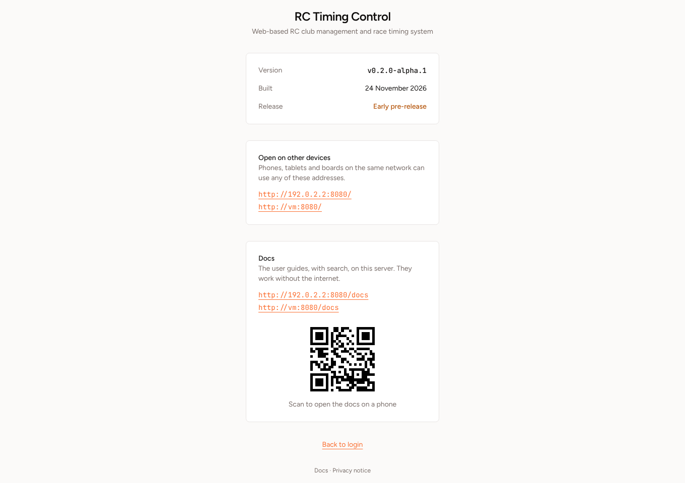
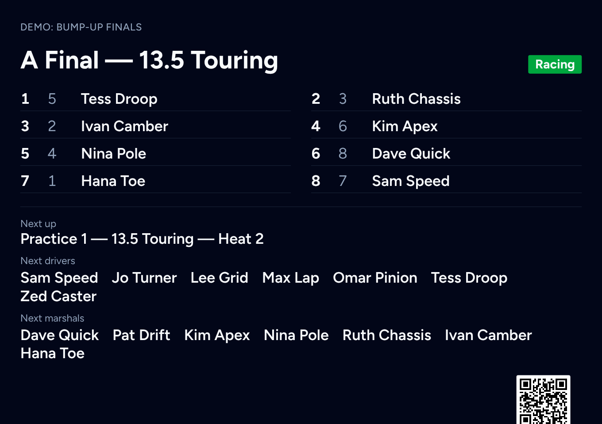
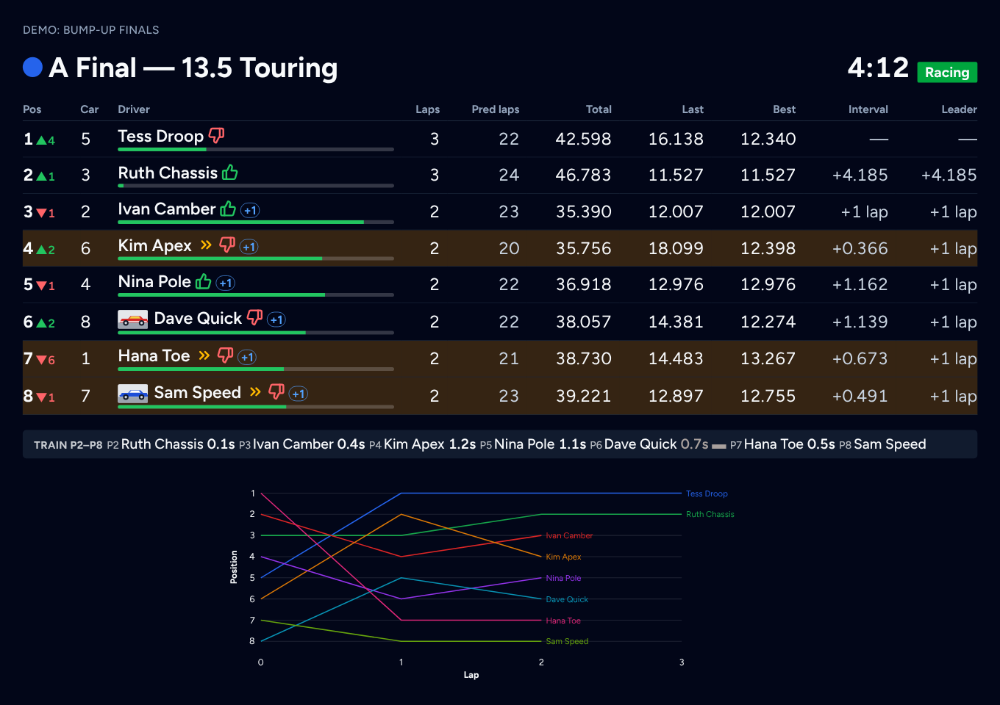
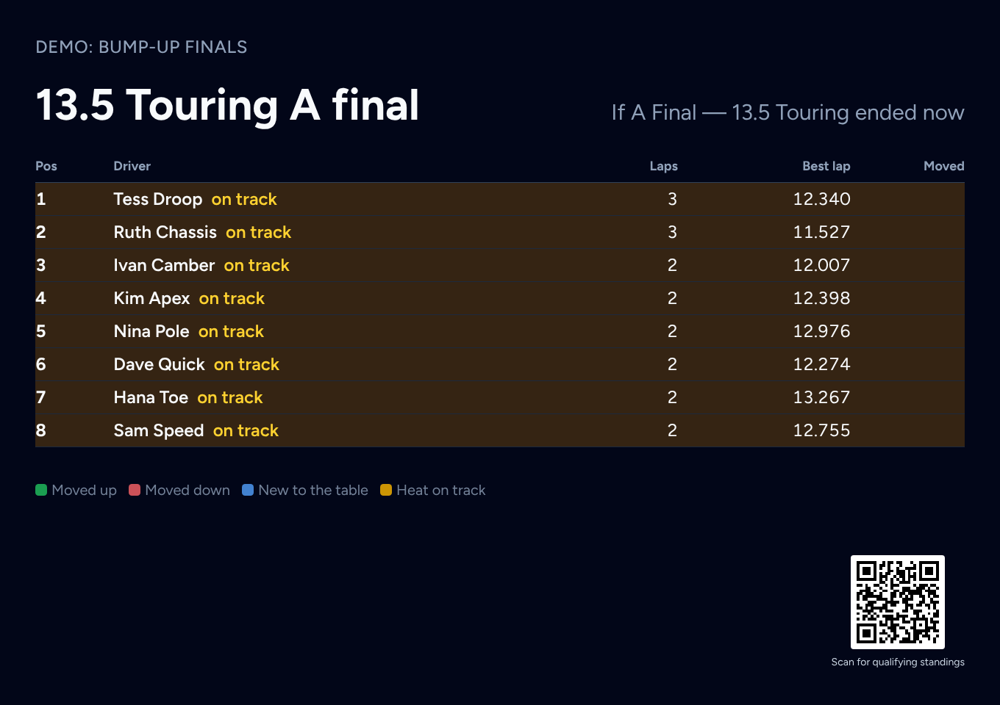
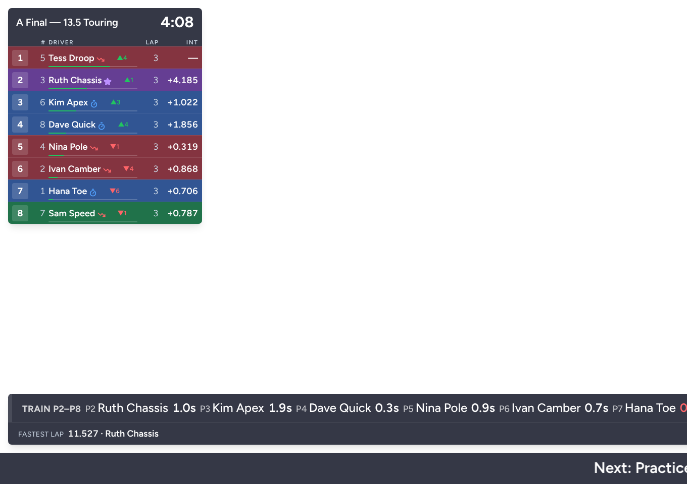
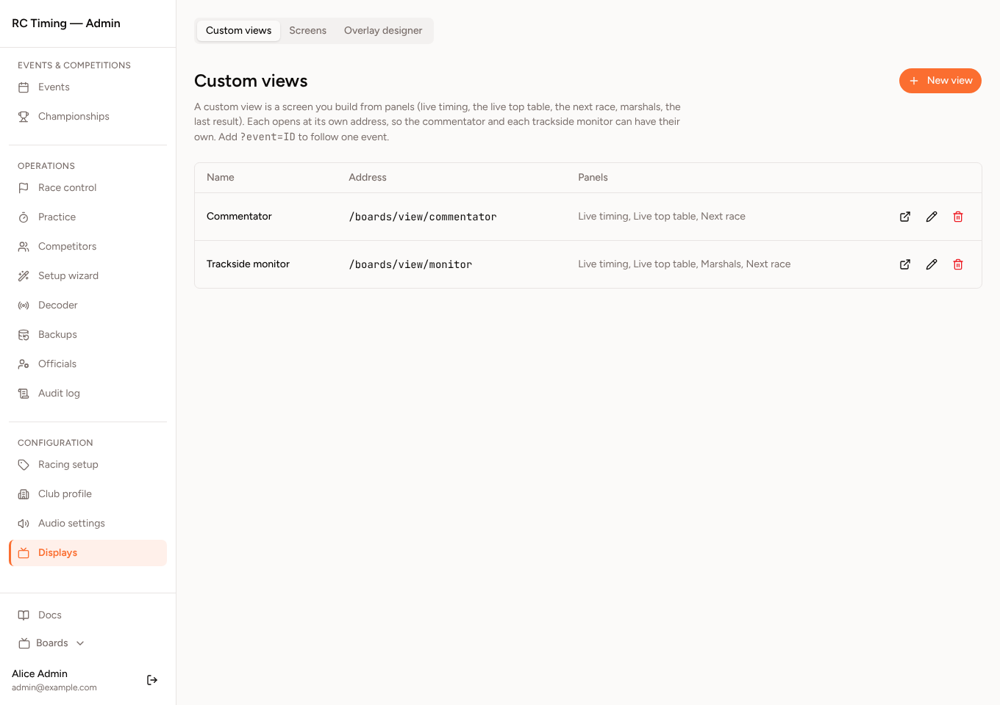
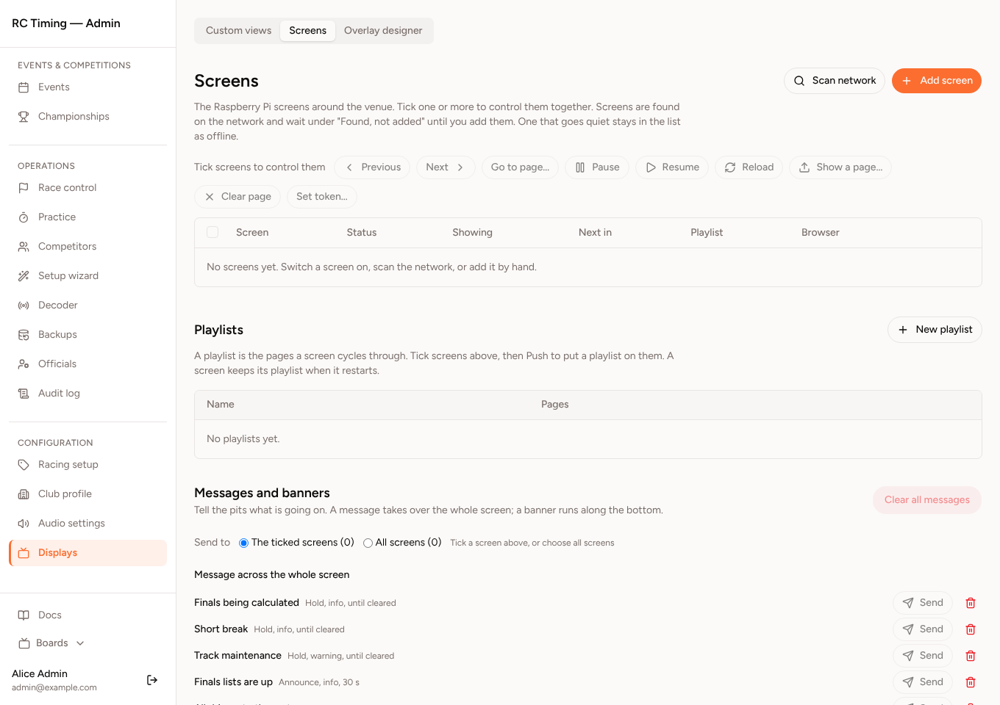
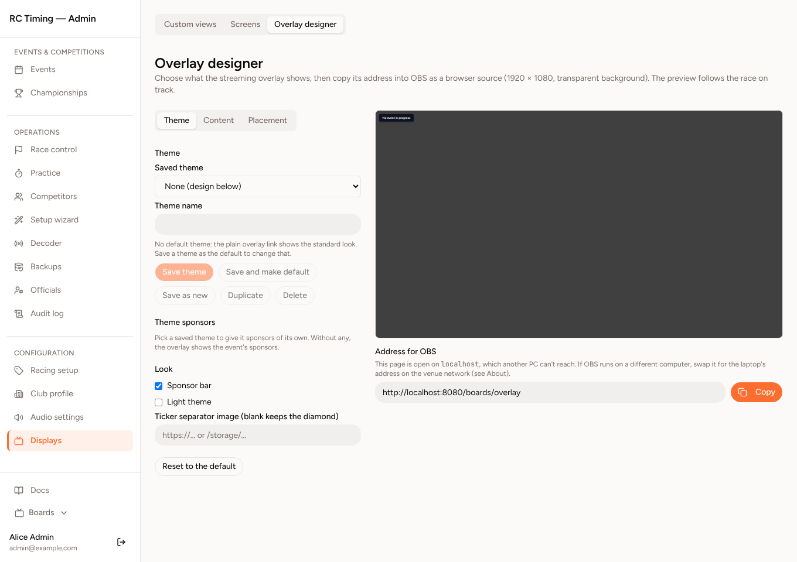
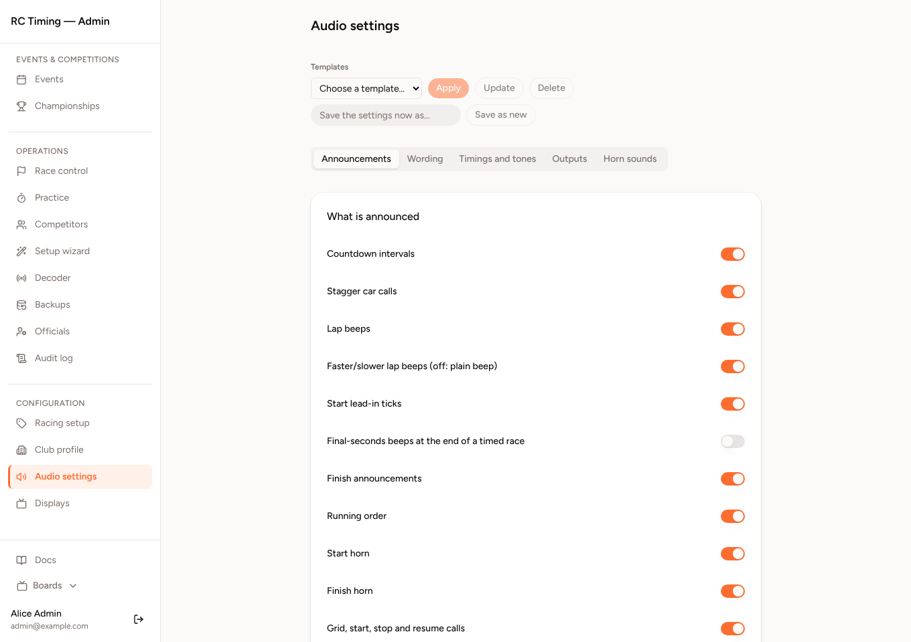
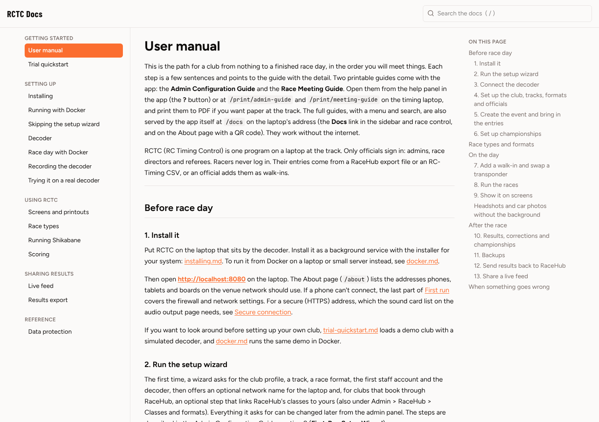

# 9. Put it on screens

Part of the [walkthroughs](../walkthroughs.md), which follow one imaginary club through a race day on the demo data.

Spectator screens need no sign-in. Open them on any phone, tablet or TV on the venue network; the **About** page lists the addresses to use.

- **Now and next** (`/boards/now-next`): the race on track and what is coming, with a countdown.

  

- **Live race** (`/boards/live-race`): live timing and the position chart.

  

- **Live top table** (`/boards/top`): the qualifying table as it changes.

  

- **Streaming overlay** (`/boards/overlay`): for OBS, with a transparent background.

  

Everything that decides what the screens show lives on one page, **Displays**, with three tabs. **Custom views** builds your own screens from panels, such as one for the commentator and one for a trackside monitor.

**Screens** manages Raspberry Pi display screens and the messages they show.

**Overlay designer** builds the overlay's address with a live preview and saves looks as named themes.

Sound has its own page, **Audio settings**, split into tabs: announcements, wording, timings and tones, outputs and horn sounds.

The **Docs** link in the sidebar opens this guide and the others inside the app, so they work at the track without the internet.

---

[← 8. Championships](8-championships.md) · [All walkthroughs](../walkthroughs.md)
